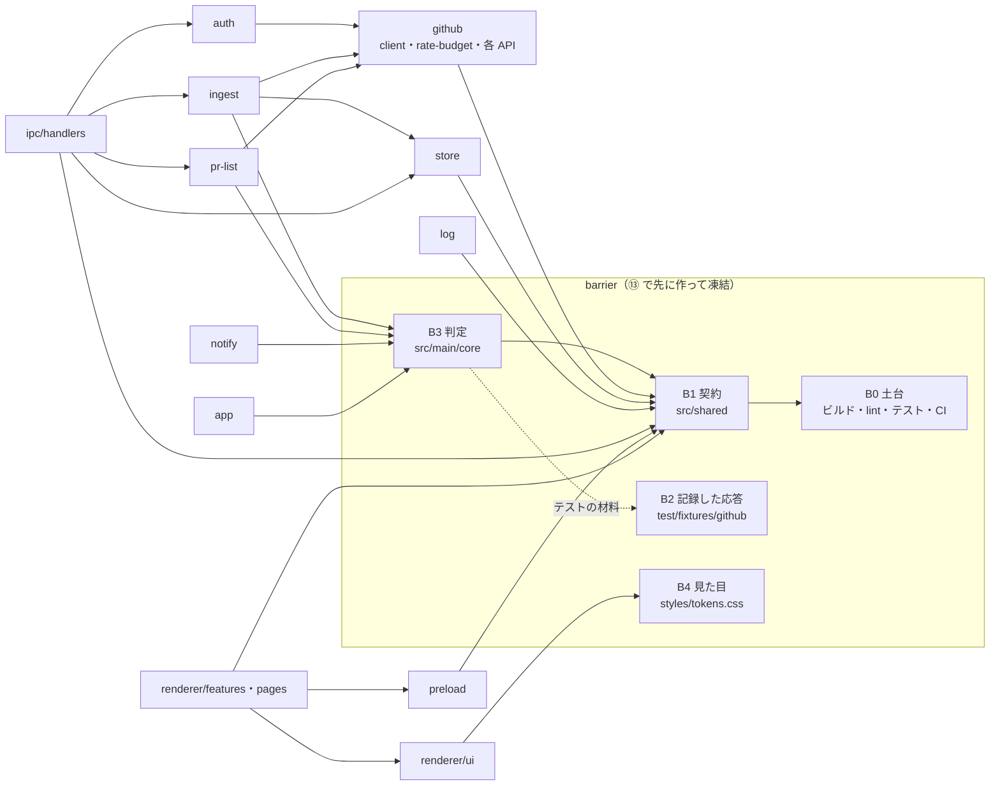

# 構築計画（build-plan.md）

- 作成: 2026-11-26（⑬ 構築計画）
- 入力: [design-review.md](../design/review/design-review.md)・[traceability-matrix.md](../design/review/traceability-matrix.md)・[risk-register.md](../design/review/risk-register.md)、[domain-model.md](../design/components/domain-model.md) 8.、[component-backend.md](../design/components/component-backend.md) 3.、[component-frontend.md](../design/components/component-frontend.md) 7.、[test-strategy.md](../design/quality/test-strategy.md)、`docs/design/conventions/`、AGENTS.md
- 状態: 1.〜4.・6.・10. は技術者が決めた（2026-11-26）。5. の中身は AI の下書きで、技術者の確認待ち。7. は ⑬ の作業で見つけた変更要求、8. は AI が決めた細部（技術者の確認待ち）
- 進め方: 実装フレーム v0.2「3.1 ⑬ 構築計画」。開発は1人＋AI 1体の直列（D-002）なので、⑭ は「契約で仕切って**順に**作る」になる。新規開発のため、実装フレーム 2.7（既存の改修）は対象外

---

## 1. 技術者が決めたこと（2026-11-26）

| 項目 | 決めたこと | 理由 |
| --- | --- | --- |
| 配布用のリポジトリの持ち主 | `zonbitamago`（github-prs と同じアカウント）。リポジトリは `zonbitamago/github-inbox`、appId は `io.github.zonbitamago.github-inbox` | 利用者に分かりやすい。build-and-release.md 1. に書いた |
| barrier（先に固める範囲） | 土台＋契約＋判定＋記録した応答＋デザイントークン（3.） | domain-model.md 8. のとおり。判定を先に固めると、後のスライスで AI が判定を推測で作る余地が無くなる |
| スライスの順番 | 骨格 → 認証 → 出来事 → デスクトップ通知 → PR の一覧 → 設定・使い始めの案内・OS との結合 → 配布（4.） | 早い段階から依頼者の実データで動かせる。リスクの大きい出来事の取り込み（R-03〜R-05）を前の方に置く |
| 凍結した契約の守り方 | Claude Code の確認設定と、CI での文書との対応の検査（6.3）。CODEOWNERS は置かない | 1人の開発では、PR を作った本人は承認できないため、CODEOWNERS は効かない |
| 並列度 | 1（直列） | D-002。独立したオーナーは技術者1人だけ |

---

## 2. 依存の関係

矢印は「左が右を使う」。

- 2つ以上の部品が読むもの: `src/shared`（ほぼ全部）、`src/main/core`（ingest・pr-list・notify・app）、`github/client`・`rate-budget`（github の全部）、`store/json-file`（出来事と設定）、`log`（メインの全部）、`tokens.css`（画面の全部）
- このうち `github/client`・`rate-budget`・`store/json-file`・`log` は barrier に入れず、使う最初のスライスで作る（3.2）

---

## 3. barrier

### 3.1 範囲と根拠

| # | 中身 | 依存の広さ | 変えたときの波及 | 終わりの合図 |
| --- | --- | --- | --- | --- |
| B0 土台 | `package.json`・Node.js の版のファイル・electron-vite の設定・TypeScript（strict、`noUncheckedIndexedAccess`）・ESLint（coding-standards.md 9. の決まりを全部）・Prettier・Vitest（網羅の測定）・`ci.yml`（ubuntu の部分）・Dependabot・`.gitignore`・PR のひな形（coding-standards.md 10.）。`src/main/index.ts`・`src/preload/index.ts`・`src/renderer/main.tsx` は空の入口だけ。CSP（security-rules.md）を入れた窓が開く | 全部 | lint や型の決まりを後で変えると、全部のコードを直すことになる | `npm run lint`・`npm run typecheck`・`npm test`・`npm run build` が通り、`npm run dev` で空の窓が開く。CI が通る |
| B1 契約 | `src/shared/domain.ts`（domain-model.md 2.・6.）、`src/shared/ipc-contract.ts`（ipc-contract.md の zod のスキーマと型） | 全部 | 型や区分値の名前が変わると、メインと画面の両方が作り直しになる | 型検査が通る。ipc-contract.md の全チャンネルにスキーマがある（契約のテストで数を突き合わせる） |
| B2 記録した応答 | `test/fixtures/github/`。GitHub の通知・timelineItems・ワークフロー実行・PR の検索・`/user`・`/user/teams` の応答を、読み取りだけで記録し、架空のデータに置き換える（test-conventions.md 3.）。domain-model.md 10. の #1・#3・#5 をここで確かめる | core・github・ingest・pr-list のテスト | 推測で応答を作ると、判定が実物とずれる（test-strategy.md 5.） | 置き換えの後、禁止語リストとトークンの形で検索して0件（security-rules.md 2.） |
| B3 判定 | `src/main/core/`: expand-thread（4.1 M-0〜M-9）・participation（4.2 PT-1〜3）・waiting-reasons（4.3 WR-0〜5）・should-notify（4.4 DN-1〜4）・url-guard（I-8）・mention。**テストを先に書く**（src/main/core/CLAUDE.md） | ingest・pr-list・notify・app | 判定が変わると、利用者に見える振る舞いが変わる | 規則ごとの表の形のテストが通り、分岐の網羅が 100% |
| B4 見た目 | `src/renderer/styles/tokens.css`（design-system.md 2.〜4. のトークン。ライトとダーク）。2.2 のラベルの色と 4. の影の値は AI が置く（design-system.md の「⑬ で AI が置く」） | 画面の全部 | 同じ意味のトークンが複数できると、画面ごとに見えがずれる | design-system.md の全トークンが CSS の変数になっている（数を突き合わせる） |

### 3.2 barrier に入れなかったもの

| 部品 | 入れなかった理由 | 作るところ |
| --- | --- | --- |
| `github/client.ts`・`rate-budget.ts` | 読むのはメインの中の github だけ。直列なので、最初に使う S2（GET /user）で作れば足りる。エラーの分類（component-backend.md 6.3）と IPC のエラーコードは B1 で凍結する | S2 |
| `store/json-file.ts`・`log/logger.ts` | 最初に使う S1 で作る。保存の形（`events.json` など）は ADR-009・component-backend.md 7. で決まっている | S1 |
| `ipc/handlers.ts`・`preload` | IPC の形は B1 で凍結する。受け口は各スライスで足していく | S1 から各スライス |

---

## 4. スライス（⑭ で順に作る）

各スライスは「触るフォルダ」の外を書かない（共有するものは barrier）。終わりの合図は「動いた」ではなく「テストが通った」（実装フレーム 3.2）。

| # | 中身 | 触るフォルダ | 要件 | テスト | 手動・実データ |
| --- | --- | --- | --- | --- | --- |
| S1 骨格 | 保存（json-file・events-store・settings-store、30日で消す、壊れたときの退避）、ログ、窓1つ・閉じたら終了・二重に立ち上げない、preload、IPC の受け口（`app:getState` など）、画面の殻（App の切り替え・main-store・一覧の殻）。保存済みの出来事を先に出す（component-backend.md 5.1） | `src/main/{store,log,app/window.ts,ipc}`、`src/preload`、`src/renderer/{App.tsx,main-store,pages/main,ui}` | F-06・F-24・N-10、I-1・I-4・I-5 | 単体（保存・30日）、結合M（壊れたファイル）、結合R（殻） | 立ち上がって、手で置いた架空の `events.json` が一覧に出る（⑭ S1 で確かめた: サインインしていない間は使い始めの案内が出るため、出来事の一覧は画面の結合のテストと `events:list` の応答で確かめた。2つめの立ち上げはすぐ終わり、窓を閉じたら終了した） |
| S2 認証 | PAT（デバイスフローは CR-007 でやめた）・トークンの保存（safeStorage の非同期版）・版が変わったときのキーチェーンの案内・`GET /user`・サインアウト。使い始めの案内の手順2と手順5（終わり。自動起動の切り替えは S6）。PAT の作成ページを開く `shell:openGitHub`。github/client と rate-budget。GitHub に書き込む呼び出しが無いことの検査（S-07）（手順5と `shell:openGitHub` は、S3 以降でメインの画面に進むため・作成ページを開くために S2 に入れた。2026-11-27 技術者が決めた） | `src/main/{auth,github/client.ts,github/rate-budget.ts,github/viewer.ts,app/external.ts}`、`src/renderer/{pages/keychain-notice,pages/onboarding,features/auth,features/onboarding,ui,main-store}`、`test/config`（S-07） | F-27・F-28・F-36 (2)(5)・N-05 | 単体（スコープの確認・トークンの形）、結合M（PAT の確かめの各応答）、結合R | 依頼者のアカウントでサインインする。前提: 5. の 0-5（2026-11-27 済み）（⑭ S2 で確かめた（2026-11-27。開発用の立ち上げ）: 作成ページが repo・notifications・説明を入れた形で開き、依頼者が作った classic PAT でサインインでき（GET /user が 200）、手順5からメインの画面に進んだ。立ち上げ直すと、キーチェーンの案内なしで読み出して GET /user で確かめ、メインの画面が出た。キーチェーンの案内は配布物が要るため S7 で確かめる） |
| S3 出来事 | GitHub の通知の問い合わせ（`If-None-Match` の ETag（CR-003）・X-Poll-Interval）、GraphQL での分解、CI の結果、取り戻し、受け取りの状態、出来事の一覧・絞り込み・状態の帯。PR を2つに分ける（2026-11-27 技術者が決めた）: **S3a** はメインの取り込み（所属チームの `GET /user/teams` を含む）、**S3b** は画面（出来事の一覧の絞り込み・開く・抜粋・状態の帯） | S3a: `src/main/{ingest,github/client.ts,github/notifications.ts,github/timeline.ts,github/workflow-runs.ts,github/viewer.ts,auth/auth-service.ts,core/select-threads.ts,core/constants.ts,index.ts}`（core は CR-010）。S3b: `src/renderer/{features/event-list,features/status,pages/main,i18n}` | F-01〜F-06・F-11〜F-13・N-01・N-04・N-07・N-08 | 結合M（模擬の GitHub。失敗・取り戻し・回数）、結合R | 依頼者の実データで種類ごとに出るか（R-04）。CI の結果は 0-7 の後。知らせの帯の「サインインし直す」は、チャンネルを足さず画面の中だけの状態にする（CR-008。2026-11-27 技術者が決めた）（⑭ S3a で確かめた（2026-11-27。開発用の立ち上げ、依頼者のアカウント、出来事の一覧の日数7日）: 取り戻しで GitHub の通知のスレッド64件のうち61件を分解し、出来事359件を保存した（約11秒。やり直すスレッド0件）。7種類すべてが出た（参加中 53・レビュー依頼 22・メンション 140・コメント 48・レビュー 25・アサイン 1・CI の結果 70）。チーム宛てのレビュー依頼は0件（データに無かった）。その後の定期の取り込みは60秒ごとで、ETag で 304 が続いた。依頼者が一覧を見て、知っている出来事が出ていることを確かめた。参加中の取りこぼし（R-04）は ⑮ で確かめる）（⑭ S3b で確かめた（2026-11-27。開発用の立ち上げ）: 依頼者が、ラベル・抜粋・時刻、文字・種類・リポジトリでの絞り込みと解き方、行を押してブラウザで開くことを確かめた。そのときに求められた、探した語の強調を足した（D-032）。受け取れていないときの帯とサインインし直す画面は画面の結合のテストで確かめ、実機の通しは ⑮ で確かめる。2,000件の一覧の重さ（component-frontend.md 5.）はまだ試していない） |
| S4 デスクトップ通知 | Notification、クリックで前面と出来事の強調（`ui:focusEvent`）、失敗の判定と帯 | `src/main/notify`、`src/renderer/features/event-list`（強調だけ） | F-07・F-08・N-09 | 結合M（出す・出さない） | アプリケーションフォルダに置いたビルドで、出る・クリックで前面に出る |
| S5 PR の一覧 | 検索3本・自分待ちの理由・リロード・期間・絞り込み | `src/main/{pr-list,github/pr-search.ts}`、`src/renderer/features/pr-list` | F-14〜F-18・F-20 | 結合M、結合R | 依頼者の PC で5秒以内か（Q-02。本番の測定は ⑮） |
| S6 設定・案内・OS | 設定の画面、使い始めの案内（手順1・3・4と、手順5の自動起動の切り替え。手順2と手順5の終わりは S2）、自動起動、アプリケーションフォルダへの移動、新しい版の確認、言語、並べ方、リンクのコピー、ライト・ダーク | `src/main/app`、`src/main/github/releases.ts`、`src/renderer/{pages/settings,pages/onboarding,features/settings,features/onboarding,i18n}` | F-09・F-16・F-23・F-25・F-26・F-31・F-33〜F-36 | 結合R、結合M（新しい版の判定） | 手動のチェックリスト（R-06・R-07・R-15） |
| S7 配布 | electron-builder の設定、`release.yml`、`ci.yml` の E2E（macOS）、Releases の説明 | `electron-builder.yml`、`.github/workflows`、`test/e2e` | F-29・F-30・C-03・C-07 | E2E（5本程度） | DMG を入れて開く（AC-43）。Hardened Runtime と ad-hoc 署名（R-08）。版の違う DMG を入れ替えて、キーチェーンの確認が出る時点と、「許可」と「常に許可」のどちらを案内するかを確かめる（auth-flow.md 4.・7.、DR-06。2026-11-27 技術者が決めた） |

- 各スライスの終わりに PR を1つ作る（大きければ分ける）。PR ごとに技術者が coding-standards.md 10. の観点で見る
- スライスの中で、設計に無いことを AI が決めたときは、PR の説明の「設計に無くて決めたこと」に書く（⑮ のレビューの材料。実装フレーム 3.2）
- 画面の見えは、各スライスの PR に画面の写しを付け、依頼者が実機で見て design-system.md を直す（⑭・⑮）

---

## 5. 着手の前と途中の作業（人がすること・確かめること）

design-review.md の「進める条件」2. と risk-register.md 2. の申し送りを、誰がいつ行うかに割り当てた。

| # | 作業 | 誰が | いつまでに | 結果を書く所 |
| --- | --- | --- | --- | --- |
| 0-1 | GitHub に `zonbitamago/github-inbox`（public）を作り、secret scanning と push protection を有効にする。最初の push で `main` ができたら、`main` を保護する（PR を必須、CI の成功を必須。承認の数は求めない。1人のため）（2026-11-26 済み。リポジトリを作った。secret scanning と push protection は有効なことを API で確かめた。`main` の保護は最初の push の後）（2026-11-26 `main` の保護も済み。ルールセットで PR と CI の `check` を必須にした） | 技術者 | 作るのは最初の push の前、保護はその直後 | security-rules.md 2. の #5 |
| 0-2 | 禁止語リスト（`.forbidden-words`。1行1語。`.gitignore` に入れる）を書く（2026-11-26 案を作った（53語）。技術者が見て直す。案での検査は0件） | 技術者 | 最初のコミットの前（B2 の記録した応答を入れる前） | — |
| 0-3 | このリポジトリのコミットの作成者のメールアドレスを GitHub の noreply のものにする（`git config user.email`）（2026-11-26 済み。このリポジトリだけ `git config --local` で noreply にした） | 技術者 | 最初のコミットの前 | security-rules.md 2. の #4 |
| 0-4 | OAuth App を登録する（auth-flow.md 1.。名前は「Inbox for GitHub」。「Enable Device Flow」をオン）。client ID を技術者に渡す（2026-11-27 名前「github-inbox」が GitHub に受け付けられず、CR-006 で名前を変えた）（2026-11-27 済み。「Inbox for GitHub」で登録した。client ID は build-and-release.md 6. に控え、S2 で `config.ts` に入れる）（2026-11-27 0-5 の結果、CR-007 で OAuth App を使わなくなった。依頼者が登録を消した） | 依頼者 | S2 の前 | build-and-release.md 6.、`src/main/auth/config.ts` |
| 0-5 | **R-02・R-03 の確認**: 0-4 の OAuth App のデバイスフローで取ったトークン（`repo notifications`）で、(1) `is:pr involves:@me` の検索の件数とエラーの件数を、gh CLI のトークンでの結果と比べる（会社のリポジトリを読めるか）。(2) `GET /user/teams` が読めるか。AI が確かめるための使い捨ての小さな仕組みを用意し、**依頼者が自分の端末で `!` を付けて動かす**（トークンが AI の会話に入らないように。出すのは件数だけ）（2026-11-27 OAuth App で確かめた。依頼者に頼まれて AI が動かした。トークンは画面にもファイルにも出さない仕組みにした。**R-02 は起きていた**: 会社の Organization の非公開リポジトリの GitHub の通知が、gh CLI では33件、OAuth App のトークンでは0件。認可の画面で、その Organization に「Request」（管理者の承認が要る）が出た。`GET /user/teams` は 200 だが0件（gh CLI では9件。アクセス制限で隠れたためか、言い切れない）。GraphQL で Team の名前を読むと `INSUFFICIENT_SCOPES`（github-api.md 3. の前提どおり）。検索 A・B の比べ合わせは、AI が確かめる仕組みに Team の項目を入れて問い合わせ全体が失敗したため、測れていない。続けて classic PAT（`repo`・`notifications`）で確かめた。gh CLI と同じだけ読めた（会社の Organization の非公開のもの: 検索 A 151件・検索 B 13件・GitHub の通知 33件。`/user/teams` は9件）。classic PAT だけにした（CR-007・D-031）。確かめに使った classic PAT と OAuth App の認可は、依頼者が片付けた。**0-5 は済み**） | 依頼者・AI | S2 の前（認証を作る前。DR-08） | ADR-004（OAuth を既定のままか、PAT を既定にするか）、domain-model.md 10. の #1、risk-register.md R-02・R-03 |
| 0-6 | **B2 の記録**（2026-11-26 済み。#3 は CR-002 で不要になり、#5 は確かめた）: gh CLI で読み取りだけの問い合わせを行い、応答をリポジトリの外（作業用の一時フォルダ）に置き、架空のデータに置き換えたものだけを `test/fixtures/github/` に置く。置き換えの対応表はリポジトリに入れない。domain-model.md 10. の #3・#5 を確かめる | AI | B3 の前 | domain-model.md 10.、risk-register.md R-04 |
| 0-7 | **R-05**: 本リポジトリの CI の実行で届く GitHub の通知（`ci_activity`）とワークフロー実行を、読み取りだけで記録する。CI を動かす push は技術者か、技術者に頼まれた AI が行う（2026-11-26 確かめた: 本リポジトリの CI（利用者が起動し、成功2回）では GitHub の通知は届いていない。GitHub の既定の設定が「失敗したワークフローだけ知らせる」ためと考えられる。技術者が決めた進め方: 技術者が GitHub の通知の設定（Settings → Notifications → System の Actions）で「Only notify for failed workflows」を外し、次に CI が動いたときに届いたものを AI が読み取りだけで記録する。利用者への案内（F-36 (3)）が正しいかも、あわせて確かめる）（2026-11-26 済み。技術者が Actions の通知を「on GitHub」にし、やり直した実行で届いたものを記録した。github-api.md 4.） | AI（記録）・技術者（push） | 0-1 と B0 の CI の後。S3 の前 | domain-model.md 10. の #2、risk-register.md R-05 |
| 0-8 | 手動のチェックリスト（`docs/build/manual-checklist.md`。試作のチェックリストを広げる）を作る | AI | S4 の前 | test-conventions.md 2. |
| 0-9 | アプリのアイコンを決める | 依頼者 | S7 の前（決まるまでは Electron の既定のアイコン） | build-and-release.md 6. |
| 0-10 | 公開リポジトリのライセンスを決める（設計で決めていない。決めるまでは `package.json` に書かない）（2026-11-26 済み。MIT。著作権者は zonbitamago。コミットの名前も、このリポジトリだけ zonbitamago にした） | 技術者 | 最初の push の前 | build-and-release.md 1.、`LICENSE` |

---

## 6. 契約の凍結

### 6.1 凍結するもの

barrier の最後の PR を `main` に入れたときに凍結し、6.4 に版を書く。

| もの | 正 |
| --- | --- |
| 共有の型・区分値・IPC の契約 | `src/shared/`（文書は domain-model.md 2.・6.、ipc-contract.md） |
| GitHub API の契約 | `docs/design/api-contract/github-api.md`・`auth-flow.md` |
| 判定の決まりと不変条件 | domain-model.md 4.・7.、`src/main/core/` |
| デザイントークン | design-system.md 2.〜4.、`src/renderer/styles/tokens.css`。**値**は ⑭・⑮ で依頼者が実機を見て直してよい（名前を変えるのは変更要求） |

### 6.2 変えたくなったとき（変更要求）

1. AI は実装を止め、`docs/build/change-requests/CR-NNN.md` を起票する（何を・なぜ・影響するスライスとテスト・代わりの案）。末尾に手戻りタグを付ける（`手戻り: 発見=⑭ / 起因=… / AI推測=… / 検知=…`。barrier に入れなかったことが原因なら起因は ⑬）
2. 技術者が可否を決める。利用者に見える振る舞いが変わるなら依頼者にも確かめ、decisions.md に残す
3. 文書（domain-model.md・api-contract・design-system.md）を先に直し、同じ PR でコードとテストを直す
4. 直列のため、追随するスライスは無い。ただし、作り終えたスライスで同じ契約を使う所は、同じ PR で直す

### 6.3 黙って変えないための仕組み（凍結のときに入れる）

| 仕組み | 中身 | 層 |
| --- | --- | --- |
| Claude Code の確認設定 | `.claude/settings.json` の `permissions.ask` に、`src/shared/**`・`src/main/core/**`（テストも含む。確認の決まりから一部だけを外す書き方の動きがはっきりしないため）・`docs/design/api-contract/**`・`docs/design/components/domain-model.md`・`src/renderer/styles/tokens.css` への Edit を入れる（`Edit` の決まりは Write にも効く。パスは `/` から書き、リポジトリの直下からの位置にする）。AI が触ろうとすると、技術者に確認が出る。リポジトリの直下で立ち上げた Claude Code に効く | 入力制約 |
| CI での文書との対応の検査 | PR で `src/shared/**` か `src/main/core/**`（`*.test.ts` と CLAUDE.md を除く）が変わっているのに、domain-model.md・`docs/design/api-contract/**`・`docs/build/change-requests/**` のどれも変わっていなければ CI を失敗させる。整理だけの変更は、PR のひな形の「契約・判定の変更ではない（整理だけ）」に印を付ければ通す（印は技術者が PR で見る。本文を直すと CI が動き直す）。`scripts/check-contract-docs.ts`、`ci.yml` | 機械的検証 |

| Claude Code の確認設定（検査） | 同じ `permissions.ask` に、検査の設定・テスト（`eslint.config.mjs`・Prettier・`tsconfig*.json`・`vitest.config.mts`・`test/config/**`・`test/contract/**`・`scripts/check-*.ts`・`.github/**`・`.claude/settings.json`・`.dependency-cruiser.cjs`）への Edit を入れる。AI が CI を通すために決まりを緩めるのを止める | 入力制約 |
| CI での決まり（検査）の変更の申告 | PR で上の検査のファイルか `package.json` の `scripts` が変わっていたら、PR の本文の「決まり（検査）を変えた」に印が要る。印が無ければ CI を失敗させる。Dependabot の PR（Action の版の上げ）は見ない。`scripts/check-guard-changes.ts`、`ci.yml` | 機械的検証 |

- 上の2つは coding-standards.md 9. に足した（2026-11-26。凍結のとき）
- 下の2つは、coding-standards.md の決まりを ESLint とテストに移したときに足した（2026-11-26。⑭ S1 の後）。決まりを機械に任せるほど、人が見るのは「決まりそのものの変更」と「例外の理由」になる。その変更を見落とさないため
- Claude Code 以外のエージェントには、AGENTS.md 行動ルール 8 と CI の検査が効く

### 6.4 凍結の記録

| 日付 | 何を | 版（`main` のコミット） | 誰が |
| --- | --- | --- | --- |
| 2026-11-26 | 6.1 の全部（PR #1 を `main` に入れた） | `dd8bbb2` | 技術者 |

---

## 7. ⑬・⑭ で見つけた設計の食い違い（変更要求）

| # | 内容 | 状態 |
| --- | --- | --- |
| [CR-001](change-requests/CR-001.md) | issue の分解の問い合わせに、レビューとレビュー依頼の型を入れられない（入れると問い合わせ全体が失敗する） | 技術者が確認した（2026-11-27。⑭ S3 の最初） |
| [CR-002](change-requests/CR-002.md) | レビューのスレッドへの返信が timelineItems に出てこない → `reviews(last: 50)` で取る | 技術者が直し方を決めた（2026-11-26） |
| [CR-003](change-requests/CR-003.md) | GitHub の通知は `If-Modified-Since` では 304 にならない → `ETag`（`If-None-Match`）にする | 技術者が確認した（2026-11-27。⑭ S3 の最初） |
| [CR-004](change-requests/CR-004.md) | M-9 の出来事の中身を取る問い合わせが無い → `latest_comment_url` を読む | 技術者が決めた（2026-11-26） |
| [CR-005](change-requests/CR-005.md) | 取り消されたレビュー（DISMISSED）をレビューの結果に写せない → 「コメントのみ」 | 技術者が決めた（2026-11-26。D-029） |
| [CR-006](change-requests/CR-006.md) | OAuth App の名前を「github-inbox」にできない（GitHub が「GitHub」で始まる名前を受け付けない）→ OAuth App の名前だけ「Inbox for GitHub」 | 技術者・依頼者が決めた（2026-11-27。⑭ の前の 0-4 で見つけた。D-030）。その後 CR-007 で OAuth App を使わなくなった |
| [CR-007](change-requests/CR-007.md) | OAuth App（デバイスフロー）では会社の非公開リポジトリを読めない（Organization の OAuth App のアクセス制限）→ classic PAT だけにする | 技術者・依頼者が決めた（2026-11-27。⑭ の前の 0-5 で見つけた。D-031） |
| [CR-008](change-requests/CR-008.md) | 知らせの帯の「サインインし直す」で、認証し直す画面に進むチャンネルが契約に無い → チャンネルを足さず、画面の中だけの状態にする | 技術者が決めた（2026-11-27。⑭ S3 の最初。作るのは S3b） |
| [CR-009](change-requests/CR-009.md) | まとめた分解の問い合わせでは、スレッドごとに `$since` を分けられない（断片の中の変数のため）→ まとめた中で一番古い since を使い、スレッドごとの絞り込みは core に任せる | 技術者が決めた（2026-11-27。⑭ S3 の最初） |
| [CR-010](change-requests/CR-010.md) | 分解するスレッドの選び方（domain-model.md 4.1）と取り込みの範囲（5.）を決める関数が core に無い → `core/select-threads.ts` と取り込みの数値の決まりを core に足す | 技術者が決めた（2026-11-27。⑭ S3 の最初） |

## 8. ⑬ で AI が決めた、設計に無かった細部（⑮ のレビューの材料）

実装フレーム 3.2 の「設計時に決まっておらず、実装者が独自に判断した箇所の一覧」。技術者の確認待ち。

| 場所 | 決めたこと | 理由 |
| --- | --- | --- |
| B0 `src/main/app/window.ts` | 窓の大きさは 960×720 | 設計に無い。一覧と PR の一覧を並べても読める大きさ |
| B0 `.prettierrc.json` | セミコロンなし・一重引用符・1行100文字 | 設計に無い。coding-standards.md 9. に書いた |
| B0 `electron.vite.config.ts` | 開発中の CSP は `style-src` と `connect-src` だけを緩め、`script-src` は緩めない | React の即時反映のスクリプトは CSP の meta より前に入るため。security-rules.md S-04 に書いた |
| B1 `ipc-contract.ts` | 依頼は `invoke(チャンネル, 引数)` の1つの関数。`SettingsPatch` の `desktopNotification` は丸ごと送る | ipc-contract.md 1.・2. に書いた |
| B3 `core/constants.ts` | 抜粋は200文字まで | 設計に無い。一覧の1行に収まる長さの目安。表示は ⑭ で依頼者が見る |
| B3 `core/expand-thread.ts` | 作者が消えたアカウント（null）は `ghost` | GitHub の画面と同じ |
| B3 `core/expand-thread.ts` | 返信だけのレビューを出来事にしたとき、開く先は返信のコメント。本文が空のレビューの抜粋は最初の行へのコメント | 開いたときに、その発言の所へ行けるように |
| B3 `core/expand-thread.ts` | レビュー依頼・アサインの出来事の開く先は PR・issue のページ | GraphQL の ReviewRequestedEvent・AssignedEvent には開く先の URL が無い |
| B3 `core/expand-thread.ts` | 分解の範囲は「since ちょうど」を含む | 重なり（5分）で重複しても、id で1件に重なる（I-1） |
| B3 `core/waiting-reasons.ts` | 作者が消えた PR も `ghost` | 上と同じ |
| B3 `core/expand-workflow-runs.ts` | CI の出来事の対象のタイトルは「ワークフロー名: 表示のタイトル（ブランチ）」 | github-api.md 4. は使う項目だけを決めていた。一覧の1行で、どのワークフローのどの変更かが分かるように |
| S1 `store/events-store.ts` | `events.json` の中の形（component-backend.md 7.）。同じ id の出来事は先に受け取ったものを残す。ファイルは字下げしない | 受け取った時刻とデスクトップ通知の判定が、後から変わらないように |
| S1 `store/settings-store.ts` | 足りない項目は既定値で補い、知らない項目は壊れたものとして退避する。無いときは変えるまでファイルを作らない | 前の版で保存したファイルも読めるように |
| S1 `log/logger.ts` | ファイルの日付は UTC。書けなかった回数を数える | ログに書けない失敗は、ほかに知らせる先が無いため |
| S1 `app/window.ts` | 配布物のメニューは、Mac はアプリ・編集・窓、Windows は出さない | 再読み込みと開発者ツールを外し、Mac のコピー・貼り付けは残すため |
| S1 `index.ts` | 開発サーバーの URL は配布物では見ない | security-rules.md S-03 に書いた |
| S1 `renderer` | 言語の仕組み（i18n）の土台を S1 で作った（計画では S6）。使い始めの案内は仮の画面。最初の値を取れなければ「開き直してください」と出す | 文言を部品に直接書かない決まり（coding-standards.md 4.）を S1 から守るため |
| 検査 `eslint.config.mjs` | `notification` を単独で使わない決まりは、コードの識別子だけに当てる。引用符の要る名前（IPC のチャンネル名など契約の文字列）と、外の部品から import する名前（Electron の `Notification`）は外す | 凍結した契約のチャンネル名（`os:openNotificationSettings` など）は「OS の通知の設定」の意味で、変えるには変更要求が要る。設計書のファイル名 `github/notifications.ts` は GitHub の API の名前をなぞるもので、ファイル名の検査では見ない |
| 検査 `test/config/coding-rules.test.ts` | CSS で書いてよい生の値は、罫線とフォーカスの輪の 1px・2px と、画面の大きさに対する値（`100vh` など）だけ。`@media` の行は見ない | design-system.md 5. の文章（2px の輪）どおり。トークンに罫線の太さは無く、`tokens.css` は凍結しているため。CSS の変数は `@media` に使えないため |
| 検査 `test/config/lint-rules.test.ts` | ESLint の決まりが効いているかを、架空のコードで確かめるテストを置いた | 設定の書き間違いで、決まりが黙って効かなくなったり効きすぎたりするのを防ぐ（作るときに1度起きた: 除外の書き方の優先順位を取り違え、外したはずの契約の名前が引っかかった） |
| 検査 `.dependency-cruiser.cjs` | どのフォルダがどこを読んでよいかの表（component-backend.md 3.1、component-frontend.md 7.）。設計書にはフォルダの一覧と役割しか無かったため、4. の役割と AGENTS.md の「特に守る範囲」から作った。`auth/` を読めるのは組み立て（`index.ts`）だけ、`github/` は `auth/`・`store/`・`ingest/` を読まない、など。テスト（`*.test.ts`）は対象の外。npm の部品・Node.js は ESLint に任せる | ⑮ の統合で、表と実際のコードの図（dependency-cruiser で書き出せる）を見比べる |
| 検査 `test/config/structure-rules.test.ts` | 構造の検査が効いているかを、架空のフォルダで確かめるテストを置いた | 作るときに1度起きた: 同じフォルダの中を許す決まりが `features/` の下までまとめて許し、Feature どうしの import が通っていた |
| 検査 `events.json` | GitHub の通知の問い合わせの記録の項目を `notifications` から `githubNotifications` に変えた | 決まり（coding-standards.md 3.）に合わせた。まだ配っていないので、前の形からの移し替えは要らない |
| S3a `ingest/ingest-service.ts` | `events.json` の「前回の成功の時刻」は、200 を受けて保存したときだけ進める（304 では書かない。component-backend.md 7.）。そのため、変わらない間は GitHub の通知の `since` も変わらず、ETag の 304 が効く | 毎回 `since` が変わると、問い合わせの URL が変わり、ETag が合わなくなるおそれがある。実際に 304 が続くかは、依頼者の実データで確かめる（S3a の手動の確かめ） |
| S3a `ingest/ingest-service.ts` | 失敗の分け方: GraphQL の別名だけの失敗と、そのリポジトリだけの 403・404 は「1つのスレッドの失敗」（続けて3回で記録を進める）。つながらない・401・利用制限・GitHub の障害は、その回の全体をやり直す。やり直すスレッドがある回は、GitHub の通知の記録も進めない | 一時の障害で、スレッドが3回の数に入って記録を進められてしまわないように。進めると、次の回が 304 になってやり直すスレッドが届かないため（component-backend.md 5.2 に書いた） |
| S3a `ingest/ingest-service.ts` | 記録の無いスレッドの分解に失敗したら、記録の「分解した時刻」を「since + 5分」にしておく | 次の回も同じ since（「分解した時刻 − 5分」）から分解するため |
| S3a `ingest/ingest-service.ts` | 立ち上げ時の取り戻しは、成功するまで `catchup` のまま。取り戻しの出来事は終わりに `events:reset` で一覧の全体として送り、`events:added` は定期の取り込みだけで送る | デスクトップ通知（S4）は `live` の出来事だけに出す（DN-1）。つながらないまま立ち上げた後、つながった回を `live` にすると、閉じていた間の出来事にデスクトップ通知が出うるため |
| S3a `ingest/ingest-service.ts` | 所属チームが読めない（障害・入れない）ときは、前の結果（初めは「読めない」）のまま進め、24時間後に読み直す。つながらない・401・利用制限なら、その回をやり直す | チームの読み取りが続けて失敗しても、取り込み全体が止まらないように（チームを読めないときの判定は domain-model.md 10. #1） |
| S3a `github/notifications.ts` | M-9 の最新のコメントが 404・形が合わない・開く先が `https://github.com/` でない・api.github.com の外を指すときは「読めなかった」（対象の作者で代える。CR-004）。つながらないなどは、その回をやり直す | 一時の障害で、発言者が実際と違う出来事を保存しないように |
| S3a `github/client.ts` | GraphQL は `query` で始まる文だけを送り、ほかは問い合わせずに断る | 書き込みをしない（N-06）ことを、コードの検査（S-07）に加えて実行時にも守る |
| S3a `ingest/ingest-service.ts` | 保存できなかった（ディスクがいっぱいなど）ときは、受け取りの状態を変えず、記録も進めずに次の回にやり直す。ログに `ingest.unexpected` を残す | GitHub の外の失敗で、受け取りの状態（ネットワーク・認証・利用制限・GitHub の障害）を誤って出さないため。区分値は増やさない |
| S3b `features/event-list/filter-events.ts` | 文字で探すときは、空白で区切った語をすべて含むものを残す（大文字と小文字は区別しない）。探すのは GitHub から取った文字（対象のタイトル・リポジトリと番号・誰が・抜粋・CI の結果）だけ | 種類とリポジトリは選択欄で絞れるため。複数の語で狭められるように |
| S3b `features/event-list/EventFilterBar.tsx` | 絞り込み中だけ「絞り込みを解く」を出す。絞り込みは保存しない（component-frontend.md 4.） | AC-16 の「条件を外すと元に戻る」を1回で行えるように。S4 のデスクトップ通知のクリックで絞り込みを解くときにも使える |
| S3b `features/event-list/EventRow.tsx` | 行全体をボタンにし、押すと出来事の URL を開くようメインに頼む。開けなければ一覧の上に理由を出す。抜粋は改行を空白にして1行で出す。チーム宛てのレビュー依頼には「チーム宛て」のラベル | キーボードでも開けるように。抜粋で行の高さがばらつかないように |
| S3b `i18n/format.ts` | 「5分前」の表し方: 1分未満は「今」、60分未満は分、24時間未満は時間、それより前は日（Intl の表し方。日本語は「5 分前」「昨日」）。1分ごとに進める | component-frontend.md 5. は形だけを決めていた。出来事は30日以内なので、月・年は要らない |
| S3b `features/status/IngestStatusBanner.tsx` | 帯には理由に加えて、最後に受け取った時刻（取り込み中を除く）と、利用制限で再開する時刻を出す。帯は `role="status"` | 受け取れていない間の長さが分かるように（N-08） |
| S3b `features/event-list/highlight.ts`・`HighlightedText.tsx` | 文字で探した語を、行の中で強調する（依頼者が実機の確かめで求めた。D-032）。色はラベルの primary の組。リポジトリと番号は、探すときも表示と同じ形（`owner/name #番号`）で探すようにそろえた | 見たままに強調できるように。新しい色のトークンは作らない（tokens.css は凍結。design-system.md 5.） |
| S3b `pages/main/MainPage.tsx` | 「サインインし直す」の画面に「出来事の一覧に戻る」を置き、サインインできたら一覧に戻す（`PatPanel` に `onSignedIn` を足した） | CR-008 の案 B。戻れないと、サインインし直すまで保存済みの出来事を見られないため |

## 9. ⑮ への申し送り

- 統合で必ず確かめる契約: IPC（`ipc-contract.ts` と preload・画面の使い方）、GitHub API（github-api.md に無い API・書き込み・`mutation` が無いこと。security-rules.md S-07）、デザイントークン（同じ意味のトークンが無いこと）
- 通しで確かめる不変条件: domain-model.md 7. の I-1〜I-8 を、取り込み → 保存 → 画面の経路で確かめる。特に I-5（取り込みの記録と出来事を同じ書き込みで保存する）を、書き込みの途中で落としたときの結合のテストで
- 実データで確かめるもの: R-04（参加中の取りこぼし）、R-09（GitHub の通知が作られるまでの遅れ）、R-10（PR の一覧の速さ）
- 通しの振り返りに持ち込むもの（技術者が振り返りの点として残すとした。2026-11-26）: **規約（coding-standards.md）をできるだけ CI で確かめ、人の確認を減らして速くする**
  - きっかけ: 技術者が PR を見ていて「規約はテストや静的解析で確かめられないか。人の判断の点が減れば全体が速くなる」と考えた（⑭ S1 の後）
  - したこと: ⑪ で「機械では拾えない」として PR のレビュー（coding-standards.md 10.）に回した8項目のうち、4項目を ESLint とテストに移し、2項目は一部を移した（残りは S2・S7 で移す）。構造（どのフォルダがどこを読んでよいか）も dependency-cruiser で確かめるようにした。検査そのものを黙って緩めないよう、検査のファイルを変えた PR は本文で申告させ、検査が効いていることもテストで確かめる
  - 分かったこと: S1 では、人のレビュー（AI の自己確認と CI）をすり抜けた決まりの違反を2つ（`notification` を単独で使った名前、1ファイルに部品2つ）と、理由の書かれていない型の主張を8か所、検査が見つけた。検査の設定の書き間違いも2度あった（外したはずの名前が引っかかった、Feature どうしの import が通っていた）。どちらも、検査が効いていることを確かめるテストを作る中で見つけた
  - ⑮ で見る数: PR で人が見る観点の数（8 → 5 → S2・S7 の後）、検査が見つけた違反の数と人が見つけた違反の数、CI の時間
  - フレームへの改善の提案の候補: ⑪ の規約の表に「確かめる手段」の欄を置き、人に残す項目には機械にできない理由を書く。⑬ で構造の検査（フォルダの読んでよい向きの表と、その機械の写し）を barrier に入れる

---

## 10. 道具と npm パッケージ

coding-standards.md 1.・9. と test-conventions.md 1. で名前が出ているもの。版は入れるときの最新の安定版にし、`package-lock.json` で固定する。Electron は試作で確かめた 45 系。

| パッケージ | 用途 | 根拠 |
| --- | --- | --- |
| `react`・`react-dom` | 画面 | ADR-003 |
| `zod` | IPC の入力・保存したファイル・GitHub の応答の検査 | ipc-contract.md、ADR-009 |
| `electron` | 本体（45 系） | ADR-003、試作 |
| `electron-vite`・`vite`・`@vitejs/plugin-react` | 開発とビルド（vite は electron-vite が求める。plugin-react は React を vite で使うため） | ADR-014 |
| `electron-builder` | 配布物（S7 で使うが、B0 で入れる） | ADR-014 |
| `typescript`・`@types/node`・`@types/react`・`@types/react-dom` | 型 | coding-standards.md 1. |
| `eslint`・`@eslint/js`・`typescript-eslint`・`eslint-plugin-react`・`eslint-plugin-react-hooks`・`globals` | lint（`globals` は flat config でブラウザ・Node の大域変数を指定するため） | coding-standards.md 9. |
| `prettier` | 書式 | coding-standards.md 9. |
| `vitest`・`@vitest/coverage-v8` | テスト・網羅の測定 | test-conventions.md 1. |
| `@testing-library/react`・`@testing-library/user-event`・`jsdom` | 画面の結合（user-event は利用者の操作を模すため） | test-conventions.md 1. |
| `msw` | 模擬の GitHub | test-conventions.md 1. |
| `dependency-cruiser` | コードの構造の検査（どのフォルダがどこを読んでよいか・循環。Java の ArchUnit にあたる） | coding-standards.md 9.。⑭ S1 の後に技術者が入れてよいとした（2026-11-26。定番の道具なので、後で読んだときに何を確かめているかが分かりやすいため） |
| `@playwright/test` | E2E（S7 で入れる） | test-conventions.md 1. |

- **名前が設計に無く、AI が足したもの**: `vite`・`@vitejs/plugin-react`・`@eslint/js`・`globals`・`@testing-library/user-event`・`@types/*`。どれも上の道具を使うために要るもの。技術者が入れてよいとした（2026-11-26）
- 入れないもの: Octokit（coding-standards.md 1.）、状態管理の部品（ADR-012）、ログの部品、CSS の部品

---

## 11. ブランチと PR

- コミット・push・PR の作成は、技術者に頼まれたときだけ行う（AGENTS.md 行動ルール 11）
- 最初のコミット: 今ある文書（`docs/`・AGENTS.md・CLAUDE.md・`src/**/CLAUDE.md`）を `main` に入れる。前に security-rules.md 2. の「最初の push の前」を通す（0-1〜0-3）。`main` の保護は、この push で `main` ができてから有効にする
- barrier: ブランチ `build/barrier` に、B0〜B4 を手順ごとのコミット（B0・B1・B2・B3・B4）で積み、PR は1つにする。どのコミットでも lint・型検査・テスト・ビルドが通ることを確かめ、技術者はコミットごとに見られるようにする（はじめは3つの PR に分ける案だったが、重ねた PR は前の PR を入れるたびに付け替えが要るため、⑬ で変えた）。PR を入れたら 6.4 に凍結を記録する
- スライス: ブランチ `slice/s<n>-<名前>`（例: `slice/s1-skeleton`）。1スライス1PR を目安にする

---

## 12. ⑬ の完了チェック（実装フレーム 付録1）

| チェック | 状態 |
| --- | --- |
| build-plan.md がある（barrier の範囲、スライス、オーナー、統合ポイント） | このファイル。統合ポイントは各スライスの PR（直列のため、スライスごとに `main` で統合される） |
| barrier の範囲が「依存の広さ」と「変えたときの波及」で判断され、根拠が残っている | 3.1 |
| barrier が直列で実装され、動く土台になっている | **済み**（PR #1 を 2026-11-26 に `main` に入れた）。B0 済み（2026-11-26。lint・型検査・テスト・ビルドが通り、開発中と配布物の両方で画面が CSP の違反なしに開く）。B1 済み（2026-11-26。`src/shared/`。文書の表とコードの区分値・チャンネルを突き合わせる契約のテストを `test/contract/` に置いた）。B2 済み（2026-11-26。`test/fixtures/github/` に9件。ただし禁止語リスト（0-2）での検査は未。CI の結果（0-7）は後で足す）。B4 済み（2026-11-26。`tokens.css`。design-system.md のトークンと過不足が無いことをテストで確かめる）。B3 済み（2026-11-26。M-0〜M-9・PT・WR・DN・URL の検査・メンションの照合。テスト150件、core の分岐の網羅 100%）。CI の結果の分解（`expand-workflow-runs.ts`）は、0-7 の記録の後に足した（2026-11-26） |
| 契約が凍結され、版が記録されている | 済み（6.4。`dd8bbb2`） |
| 契約を変えたくなったときの手続きが決まり、共有されている | 6.2。AGENTS.md に書く |
| ディレクトリの所有が割り当てられ、機械で守れる形になっている | 済み（6.3 の2つを入れた）。オーナーは全部が技術者 |
| 並列度が、独立したオーナーにできるスライスの数と統合のレビューの余力から決められている | 1.（並列度1） |
| 既存の改修の場合、回帰テストと切り戻しの手順がある | 対象外（新規開発） |
