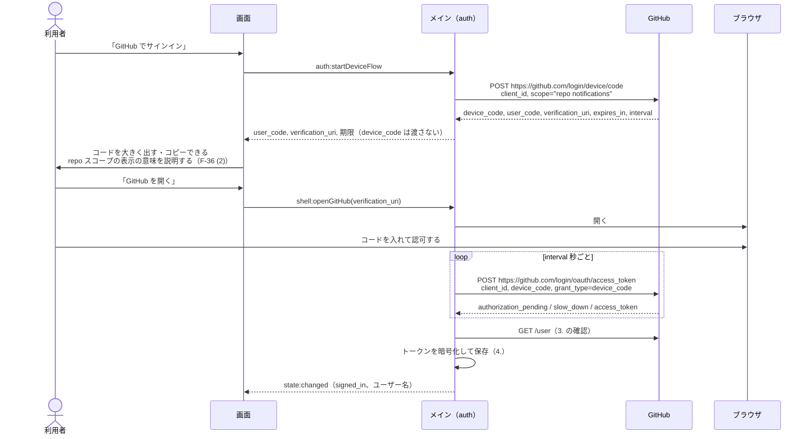

# 認証の流れ（auth-flow.md）

- 作成: 2026-11-26（⑩.3 インターフェース設計）
- 入力: ADR-002・004・007、[requirements.md](../../requirements/requirements.md) F-27・F-28・F-36・N-05、[試作の記録](../review/spike-unsigned-electron-mac.md)
- 状態: 技術者が確認済み（2026-11-26）。「AI案」と書いた項目も技術者がこの内容で確認した
- 更新: 2026-11-26 ⑫ の設計レビューを反映（DR-06・08）

---

## 1. 方式と権限

| 項目 | 内容 |
| --- | --- |
| 既定 | OAuth App のデバイスフロー（ADR-004）。client secret は使わない |
| もう1つ | classic の PAT を貼る（ADR-004）。fine-grained PAT は使えない（GitHub の通知 API が対応していない。ADR-002） |
| スコープ | `repo` と `notifications`（ADR-002）。`read:org` は求めない（domain-model.md 10. 要確認 1） |
| OAuth App | 依頼者が個人アカウントで1つ登録する。名前は「github-inbox」、ホームページの URL は配布用の公開リポジトリ、コールバックの URL も同じ（デバイスフローでは使わないが、登録に要る）。「Enable Device Flow」をオンにする |
| client ID | コードの定数に置く（`src/main/auth/config.ts`）。公開されても問題ない（ADR-004） |

---

## 2. デバイスフロー

| GitHub の応答 | 扱い |
| --- | --- |
| `authorization_pending` | 待ち続ける |
| `slow_down` | 間隔を応答の `interval`（無ければ +5秒）にする |
| `expired_token` | `deviceFlow.status = 'expired'`。「もう一度」で最初から |
| `access_denied` | `deviceFlow.status = 'denied'` |
| その他のエラー・つながらない | 失敗を画面に出し、PAT も選べることを示す |

- 画面を閉じた・「やめる」を押した（`auth:cancelDeviceFlow`）ら、問い合わせをやめる
- `verification_uri` は `https://github.com/` で始まることを確かめてから開く（I-8）

---

## 3. PAT とトークンの確認

- 画面に、スコープを入れた作成ページへのリンク（`https://github.com/settings/tokens/new?scopes=repo,notifications&description=github-inbox`）と、貼り付け欄を出す
- 貼られたら `auth:submitPat` でメインに送る。メインは前後の空白を除いてから確かめる

デバイスフローと PAT のどちらも、保存する前に次を確かめる。

| 確かめること | 失敗のとき |
| --- | --- |
| `GET /user` が 200 で返る | `pat_invalid`（デバイスフローなら `github_error`） |
| 応答の `X-OAuth-Scopes` に `repo` がある（`repo` があれば GitHub の通知 API も読める） | `pat_missing_scope`。fine-grained PAT（ヘッダーが無い）もここ |
| OS の安全な保管場所が使える（safeStorage の `isEncryptionAvailable()`） | `encryption_unavailable`。平文では保存しない（N-05） |

---

## 4. トークンの保管と読み出し

- safeStorage の**非同期版の関数**で暗号化し、`token.bin` としてユーザーフォルダに置く（ADR-004、Q-10）。Mac はキーチェーン、Windows は DPAPI の鍵を使う
- 読み出すのは `main/auth` だけ。`github/client` には「トークンを返す関数」を渡し、トークンそのものを持たせない（I-7）
- ログ・IPC・保存した出来事・URL に出さない。念のため、ログに書く文字列からトークンの形（`gho_`・`ghp_`・`github_pat_` で始まるもの）を消す処理も入れる（AI案）

### 版が変わったとき（Mac。F-36 (5)）

署名しないアプリでは、版を上げるたびに、キーチェーンの確認が1回出る（D-022、試作で確認）。確認が出る前に案内する。

1. 立ち上げたとき、`settings.json` の `lastLaunchedVersion` と今の版を比べる。`settings.json` は暗号化していないため、キーチェーンに触れずに読める
2. 違っていて `token.bin` があれば、トークンを読み出す前に `auth.status = 'keychain_notice'` にする。画面は「この後キーチェーンの確認が出ます。『常に許可』を押してください」と出す（要件の文言は「許可」。どちらを案内するかは ⑭ で確かめて決める。7.、DR-06）
3. 利用者が「続ける」を押したら（`auth:continueAfterKeychainNotice`）、トークンを読み出す。ここで確認が出る
4. 読み出せたら `lastLaunchedVersion` を今の版にする。断られた・読めなかったときは、認証し直す画面に進む（トークンは消さない）

- **要確認**: 確認が出るのが safeStorage を呼んだときか、Chromium が立ち上げ直後に鍵に触れるときか。後者なら 2. の案内は間に合わない。その場合は、新しい版の知らせ（F-31）と Releases の説明で、入れ直す前に予告する。⑭ で手動で確かめる（component-backend.md 11.）
- Windows（DPAPI）では確認は出ないため、この案内は出さない

---

## 5. 認証が切れたとき

- GitHub が 401 を返したら、受け取りを止めて `auth.status = 'auth_failed'`・`ingest.state = 'auth_failed'` にする（component-backend.md 6.3）
- 画面は理由と「サインインし直す」を出す（N-08）。保存済みの出来事は残す
- サインインし直したら、取り戻しから再開する

---

## 6. サインアウト（F-28）

- `token.bin` を消す。出来事と取り込みの記録（`events.json`）も消す（別のアカウントでサインインし直すときに、前のアカウントの出来事を残さないため。AI案）。設定は残す
- アプリからは GitHub 側のトークンを取り消せない（取り消しの API には client secret が要る）。サインアウトの画面で、GitHub の設定ページ（OAuth App は `https://github.com/settings/applications`、PAT は `https://github.com/settings/tokens`）を開けるようにし、取り消しを勧める（AI案）

---

## 7. 要確認

| 項目 | 確かめなかった場合の扱い | 誰が・いつ |
| --- | --- | --- |
| 会社の Organization で、OAuth App のアクセス制限（third-party application access policy）が有効か。有効なら、管理者の承認が無いと会社のプライベートリポジトリを読めない（C-02 に反する） | 依頼者の OAuth App で認証し、会社のリポジトリの PR を分解できるか確かめる。読めなければ、classic PAT を既定にする（OAuth App のアクセス制限は PAT にはかからない。ただし Organization が classic PAT の利用を別に制限している場合は、PAT も使えない） | 依頼者・**⑬ の最初の作業**（認証を作る前。DR-08） |
| 4. のキーチェーンの確認が出る時点 | 4. の要確認のとおり | AI・⑭ |
| 4. で案内するボタン（「許可」か「常に許可」か）。「許可」だけだと、次の立ち上げでも確認が出るか | 確かめるまでは、どちらかに固めない。結果で要件（F-36 (5)・AC-42）と画面・Releases の文言を揃える。要件の文言を変えるなら依頼者に知らせ、decisions.md に残す | AI・⑭（DR-06） |
