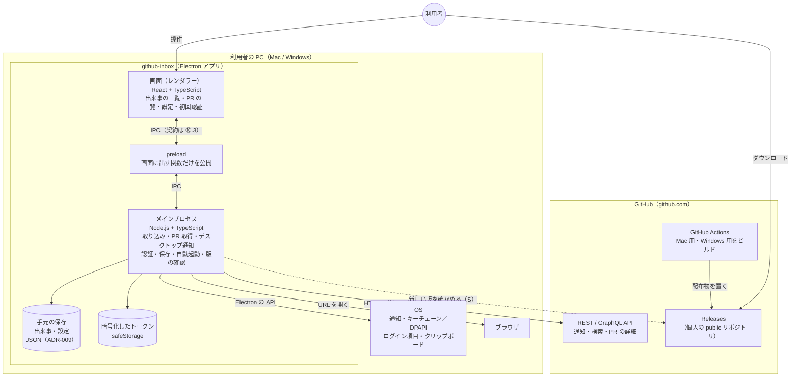

# Container 図の説明（container-overview.md）

- 作成: 2026-11-26（⑧ アーキテクチャ設計（構造））
- 入力: [context-overview.md](context-overview.md)、[requirements.md](../../requirements/requirements.md)、[acceptance.md](../../requirements/acceptance.md)、ADR-001・002
- 図: [container-diagram.mmd](container-diagram.mmd)
- 状態: 技術者が確認済み（2026-11-26）。ADR-003〜007 を採用。⑨ で ADR-008、⑩ で ADR-009〜012 を追加し、中の部品は `docs/design/components/`・`docs/design/api-contract/` に書いた。署名しないアプリの振る舞いは試作で確かめた（[review/spike-unsigned-electron-mac.md](../review/spike-unsigned-electron-mac.md)）
- 更新: 2026-11-27 デバイスフロー（OAuth App）をやめ、図と表から外した（CR-007）

github-inbox の内側の構成（デプロイ単位と通信）と、主な技術選択を示す。開発は1人 + AI 1体の直列（D-002）なので、分割のしやすさの観点（設計フレーム 2.5節）は軽く扱う（6.）。

---

## 1. Container 図

---

## 2. Container と役割

| Container | 技術 | 役割 | 主な要件 |
| --- | --- | --- | --- |
| メインプロセス | Electron（Node.js）+ TypeScript | GitHub の通知の取り込みと出来事への分解、PR の一覧の取得、デスクトップ通知、認証とトークンの保管、手元の保存の読み書き、自動起動の登録、新しい版の確認、ブラウザで開く、クリップボードへのコピー。**GitHub とトークンを扱うのはここだけ**（ADR-007） | F-01〜F-09、F-20、F-24、F-25、F-27、F-28、F-31、F-34、N-01、N-04〜N-08 |
| preload | Electron の contextBridge | 画面に出す関数（IPC の窓口）だけを公開する。Node.js の機能やトークンは画面に出さない（ADR-007） | N-05 |
| 画面（レンダラー） | React + TypeScript | 出来事の一覧、PR の一覧、設定、初回認証、受け取れていない表示。GitHub には直接つながない | F-11〜F-18、F-22（C。入れるときに設計する）、F-26、F-32、F-33、N-08 |
| 手元の保存 | JSON ファイル（ADR-009。component-backend.md 7.） | 受け取った出来事と設定を残し、次に立ち上げたときは閉じていた間の分だけ取る（ADR-006） | F-06、F-09、F-16、F-25、F-26、F-32、F-33 |
| 暗号化したトークン | Electron の safeStorage（Mac はキーチェーン、Windows は DPAPI で暗号化） | GitHub のトークンを平文で置かない（ADR-004） | N-05 |

ウィンドウは1つで、閉じたらアプリを終了する（F-24）。メニューバー・タスクトレイのアイコンは作らない（C-04）。

---

## 3. 通信

| どこ → どこ | 方式 | 中身 | 確定する工程 |
| --- | --- | --- | --- |
| 画面 ⇄ メインプロセス | Electron の IPC（preload で公開した関数だけ） | 出来事の一覧・PR の一覧・設定の読み書き・認証の開始・「受け取れていない」状態・リンクのコピー・GitHub を開く | ⑩.3 済み（[ipc-contract.md](../api-contract/ipc-contract.md)） |
| メインプロセス → GitHub API | HTTPS（GitHub の通知は REST、出来事への分解と PR の一覧は GraphQL。ADR-010）。classic のトークン | 通知（`If-None-Match`（ETag。CR-003）・`X-Poll-Interval` に従う）、検索（`involves:@me`）、PR・issue・コメント・レビュー・チェックの詳細。読み取りだけ | ⑩.3 済み（[github-api.md](../api-contract/github-api.md)） |
| メインプロセス → GitHub の認証 | —（使わない） | デバイスフローは CR-007 でやめた。認証は利用者が作る classic PAT を貼るだけで、GitHub の認証の口にはつながない（ADR-004） | ⑩.3 済み（[auth-flow.md](../api-contract/auth-flow.md)） |
| メインプロセス → GitHub Releases | HTTPS（公開リポジトリの最新リリースを見る） | 新しい版があるか（F-31、S） | ⑩.3 済み（[github-api.md](../api-contract/github-api.md) 6.） |
| メインプロセス → OS | Electron の API（Notification、safeStorage、ログイン項目の設定、clipboard、外部ブラウザで開く） | デスクトップ通知・トークンの暗号化・自動起動・コピー・GitHub を開く | ⑩.2 |
| GitHub Actions → Releases | GitHub Actions のワークフロー | Mac 用・Windows 用の配布物をビルドして置く（ADR-005） | ⑪・⑬ |

---

## 4. 主な技術選択（ADR）

| ADR | 決定 | ステータス |
| --- | --- | --- |
| [ADR-003](../adr/ADR-003.md) | Electron + React + TypeScript で作る | 採用 |
| [ADR-004](../adr/ADR-004.md) | 認証は利用者が作る classic PAT の貼り付けにする。トークンは safeStorage で暗号化して保存する | 採用（2026-11-27 改訂。CR-007） |
| [ADR-005](../adr/ADR-005.md) | 個人の public リポジトリで開発し、GitHub Actions でビルドして GitHub Releases で配る | 採用 |
| [ADR-006](../adr/ADR-006.md) | 受け取った出来事と設定を手元に保存し、GitHub からは差分だけ取る | 採用 |
| [ADR-007](../adr/ADR-007.md) | GitHub とトークンはメインプロセスだけが扱い、画面には preload で公開した関数だけを渡す（AI案） | 採用 |
| [ADR-008](../adr/ADR-008.md) | Mac は DMG、Windows は利用者ごとに入れるインストーラーで配る（⑨ で追加） | 採用 |
| [ADR-009](../adr/ADR-009.md) | 手元の保存は JSON ファイル（⑩ で追加） | 採用 |
| [ADR-010](../adr/ADR-010.md) | GitHub の通知は REST、出来事への分解と PR の一覧は GraphQL（⑩ で追加） | 採用 |
| [ADR-011](../adr/ADR-011.md) | メインプロセスは機能ごとのフォルダ、判定は純粋な関数として core に集める（⑩ で追加） | 採用 |
| [ADR-012](../adr/ADR-012.md) | 画面の状態は React 標準の仕組みで持つ（⑩ で追加） | 採用 |
| [ADR-013](../adr/ADR-013.md) | AI エージェントは Claude Code を主に使い、ルールの正は AGENTS.md に置く（⑪ で追加） | 採用 |
| [ADR-014](../adr/ADR-014.md) | 開発とビルドは electron-vite、配布物は electron-builder、Mac 用は両対応の1つ（⑪ で追加） | 採用 |

---

## 5. 気をつけること

| 内容 | 扱い |
| --- | --- |
| **リポジトリを公開する**ため、コードだけでなく `docs/`（要件定義の記録を含む）も公開される。会社名・Organization 名・社内の事情・実データを書かない。今の `docs/` には会社名や Organization 名は書いていないが、チームの規模や Slack が使えない事情などは書いてある | 最初に push する前に、技術者が `docs/` を見直す（7.） |
| 署名しないアプリの振る舞い | Mac は試作で確かめた: デスクトップ通知・自動起動・safeStorage・切り替え・閉じたら終了は動く。ただしデスクトップ通知はアプリケーションフォルダに置くことが前提で、版を上げるたびにキーチェーンの確認が1回出る（D-022）。**Windows は確かめていない**（⑫ のリスク登録簿に入れる） |
| PAT の作成ページでは、`repo` スコープが「プライベートリポジトリの完全な制御」と表示される。アプリは書き込まない | PAT を作る前にアプリの画面で説明する（F-36） |

---

## 6. 分割のしやすさ（直列のため軽く）

開発は直列（D-002）で、並列実装はしない。将来チームで手を入れる場合に備え、次の境界だけ意識しておく。

- 画面とメインプロセスの間の IPC の契約（⑩.3）。ここが画面側と取り込み側の境界になる
- 出来事の種類・自分待ちの理由などの区分値（business-data.md）は、画面とメインプロセスで共有する型にする（⑩.1）

---

## 7. 引き継ぎ事項

### ⑨ へ

- 問い合わせの間隔（`X-Poll-Interval` に従う）と、出来事への分解に要る追加の問い合わせの回数を見積もり、5分以内（N-01）と利用制限（N-04）を定量化する
- 立ち上げ時に閉じていた間の分を取るときの問い合わせ量（最大30日分）と、一覧が出るまでの時間（NF-03）
- メモリの目安は上限を置かない（NF-04）。Electron で数百 MB を想定
- トークンの保管（safeStorage）で N-05 を満たすか

### 試作（実施済み）

- Mac で実施した（review/spike-unsigned-electron-mac.md）。デスクトップ通知に失敗したときに画面で知らせる要件（N-09）を加えた（D-022）

### ⑩ へ（⑩ で決めた。[domain-model.md](../components/domain-model.md)・[component-backend.md](../components/component-backend.md)・[component-frontend.md](../components/component-frontend.md)・`api-contract/`）

- 手元の保存の形式（SQLite／JSON など）と、出来事の識別子（⑩.1）
- IPC の契約、GitHub への問い合わせの形（REST か GraphQL か）（⑩.3）
- メインプロセスの中の部品の分け方（取り込み・PR・通知・認証・保存）（⑩.2）
- 画面の部品の分け方と、並べ方の切り替え（F-33）（⑩.4）

### ⑪ へ（⑪ で書いた。[build-and-release.md](../conventions/build-and-release.md)、[security-rules.md](../conventions/security-rules.md) 2.）

- 配布物を作る道具（electron-builder など）と GitHub Actions のワークフロー、リポジトリ公開前の見直しの手順

### 最初の push の前に

- `docs/` を見直し、公開してよい内容か確かめる（5.）
