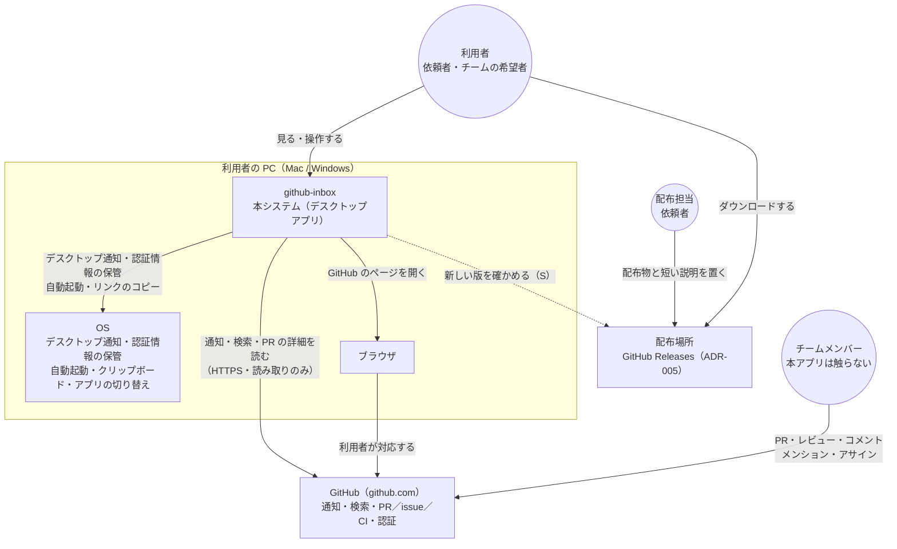

# Context 図の説明（context-overview.md）

- 作成: 2026-11-26（⑦ アーキテクチャ設計（全体像））
- 入力: [intent.md](../../requirements/intent.md)、[business-flow.md](../../requirements/business-flow.md)、[requirements.md](../../requirements/requirements.md)、[acceptance.md](../../requirements/acceptance.md)、[summary.md](../../requirements/summary.md)
- 図: [context-diagram.mmd](context-diagram.mmd)
- 状態: 技術者が確認済み（2026-11-26）
- 更新: 2026-11-26 ⑫ の設計レビューを反映。⑧・⑩ で決めた「未定」を直した（DR-11）

github-inbox の境界（誰が使い、何と通信するか）を示す。greenfield のため、既存システムとの差分の観点（設計フレーム 2.4節）は扱わない。

---

## 1. Context 図

---

## 2. 人

| 人 | 本アプリとの関わり | 根拠 |
| --- | --- | --- |
| 利用者（依頼者・チームの希望者） | 本アプリを立ち上げたまま使う。各自の PC に入れ、各自の GitHub アカウントで認証する | intent.md 2.、D-005 |
| 配布担当（依頼者） | Mac 用・Windows 用の配布物と短い説明を配布場所に置く。本アプリの動作には関わらない | business-flow.md F4 |
| チームメンバー | GitHub 上で出来事を起こすだけで、本アプリは触らない | business-flow.md 1. |

Organization の管理者は登場しない。外部のアプリやトークンからの読み取りに管理者の承認は要らず（business-flow.md 1.）、SAML SSO も使っていない（D-019）。

---

## 3. 外部システムと通信

| 相手 | 本アプリとやり取りすること | 方式の候補（⑧・⑩.3 で確定） | 本アプリへの影響 |
| --- | --- | --- | --- |
| GitHub（github.com） | 自分宛ての通知を読み、出来事の中身（コメント・レビュー・CI の結果）と PR の一覧を取る。認証する。**書き込みはしない** | 通知 API（REST、`ETag` による差分の問い合わせ（CR-003）、`X-Poll-Interval` に従う）／検索（PR の一覧。github-prs と同じ `involves:@me`。⑩ で GraphQL にした）／出来事の分解と PR の詳細（GraphQL。ADR-010）／認証は classic のトークン（OAuth App または classic PAT。`notifications`・`repo` スコープ）。ADR-002 | GitHub が止まる・利用制限にかかると受け取れない（N-08 で画面に出す）。各自の GitHub の通知設定が受け取りに影響する（4.） |
| OS（Mac / Windows） | デスクトップ通知を出す、認証情報を安全に保管する、ログイン時に立ち上げる、リンクをクリップボードに入れる、アプリの切り替えの対象になる | 通知センター（Mac）／トースト通知（Windows）、キーチェーン（Mac）／資格情報マネージャー（Windows）、ログイン項目・スタートアップ | 署名しないアプリ（C-03）を OS がどう扱うかは未確認（requirements.md 5. #5） |
| ブラウザ | GitHub の該当ページを開く | OS の既定のブラウザで URL を開く | なし |
| 配布場所 | 利用者が配布物をダウンロードする。本アプリが新しい版を確かめる（F-31、S） | GitHub Releases（ADR-005） | 新しい版の確認が止まっても、受け取りには影響しない |

---

## 4. GitHub 側の前提（利用者の設定）

出来事の起点を GitHub の通知にした（ADR-002）ため、各自の GitHub の通知設定によって受け取れる範囲が変わる。アプリの初回の案内（F-36）で次を案内する（D-019・D-024）。

| 設定 | 必要な状態 | 影響する出来事 |
| --- | --- | --- |
| Participating, @mentions and custom（参加・メンション） | 「on GitHub」がオン | レビュー依頼・レビュー・コメント・メンション・アサイン・参加中の PR への発言 |
| Actions（ワークフローの実行） | 「on GitHub」がオン。「失敗したものだけ通知する」をオフ | CI の結果（AC-04 はすべての結果を出す） |

依頼者のデータでは、直近7日に CI の結果の通知（理由 `ci_activity`）が0件だった（acceptance.md 4.）。上の設定がオフになっている可能性がある。

---

## 5. 含めないもの

| 含めないもの | 判断と根拠 |
| --- | --- |
| 自前のサーバー（Webhook の中継など） | 置かない。管理者の操作と運用が要るため（ADR-001） |
| Slack・Microsoft Teams | 社内で使えない（intent.md 6.） |
| GitHub Mobile・Gitify | 本アプリとはつながない（W-09） |
| Organization の管理者 | 承認が要らないため登場しない（2.） |
| GitHub の Events API | 使わない。即時の用途向けではない（ADR-002） |
| 監視・ログの基盤 | 置かない。各自の PC で動くデスクトップアプリで、サーバーが無いため。障害の調べ方（手元のログなど）は ⑨ で扱う |

---

## 6. 対象とするリポジトリ

利用者のアカウントに関わるすべてのリポジトリを対象にする（会社の Organization、個人、OSS を含む）。github-prs と同じ（D-019）。ただし、Watch しているだけのリポジトリの出来事（通知の理由 `subscribed`）は扱わない（W-03）。

---

## 7. 引き継ぎ事項

### ⑧ へ

- 認証の方式: OAuth App（デバイスフローなど）／利用者が作る classic PAT／gh CLI のトークンの再利用、のどれにするか。いずれも classic で `notifications`・`repo` スコープ（ADR-002）
- 配布場所と、新しい版の確かめ方（F-31）
- アプリの作り方（フレームワーク）。軽さより使い心地を優先する（acceptance.md NF-04）。署名しない前提で、デスクトップ通知・自動起動・OS の警告がどう振る舞うかを確かめる

### ⑨ へ

- GitHub の可用性と利用制限が S1（5分以内）に直結する。問い合わせの間隔は `X-Poll-Interval` に従う前提で、5分以内に収まるかを定量化する
- トークンは `repo` スコープ（読み書きを含む）を持つため、漏れたときの影響が大きい。保管（N-05）の強さを決める

### ⑩ へ

- 通知（スレッド）は PR・issue ごとにまとまり、理由はスレッド単位で変わりうる。個々の出来事への分解と種類の判定は、通知が指す PR・issue の中身を見て行う（⑩.1・⑩.3）
- 通知の理由と出来事の種類の対応、扱わない理由（`subscribed`・`state_change`・`approval_requested` など）の整理（⑩.1）

---

## 8. 未定の事項

| 項目 | 状態 |
| --- | --- |
| ~~チームがメンションされた（通知の理由 `team_mention`）ときに、出来事の「メンション」として扱うか~~ | 決定: メンションとして扱う（D-020） |
| 認証の方式・配布場所・アプリの作り方 | 決めた（⑧）: ADR-003・004・005 |
