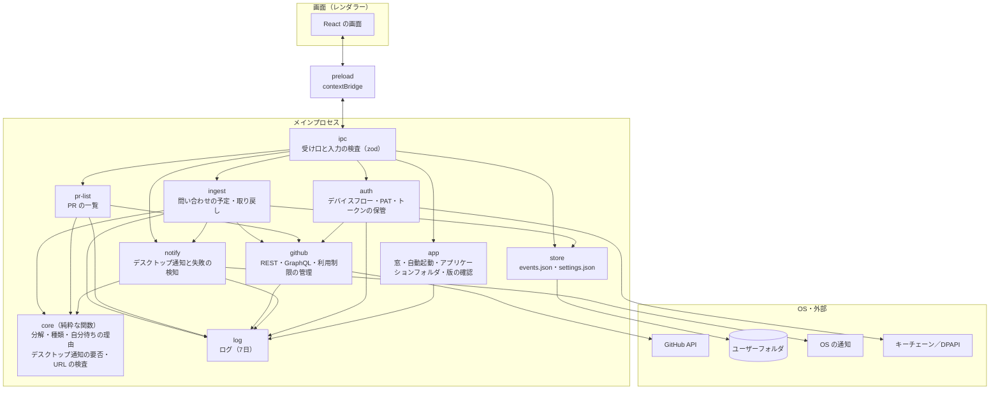
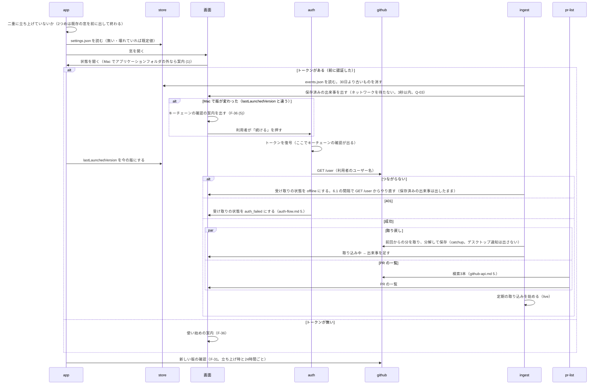

# メインプロセスの部品（component-backend.md）

- 作成: 2026-11-26（⑩.2 バックエンドコンポーネント設計）
- 入力: [container-overview.md](../architecture/container-overview.md)、[domain-model.md](domain-model.md)、[non-functional.md](../quality/non-functional.md)、[test-strategy.md](../quality/test-strategy.md)、ADR-004・006・007・009・010・011
- 状態: 技術者が確認済み（2026-11-26）。部品の分け方（機能ごと＋判定は純粋な関数）は技術者が決めた（ADR-011）。「AI案」と書いた項目も技術者がこの内容で確認した
- 更新: 2026-11-26 ⑫ の設計レビューを反映（DR-02・05・06・07・10・19）

本アプリにサーバーは無い。この文書の「バックエンド」は、Electron のメインプロセス（GitHub・トークン・保存・OS を扱う側。ADR-007）を指す。

---

## 1. 方針

- **機能ごとのフォルダ**に分ける（取り込み・PR の一覧・デスクトップ通知・認証・保存・アプリ）。1つの機能を直すときに触るフォルダを少なくする（ADR-011）
- **判定は `core` に集める**。出来事への分解・種類の判定・自分待ちの理由・デスクトップ通知を出すか・URL の検査は、ネットワークもファイルも時計も触らない純粋な関数にする。単体テストを厚くする（test-strategy.md 1.）
- **外とつながる所だけ差し替えられるようにする**（依存の向きを逆にするのはここだけ）: 時計・GitHub への HTTP・ファイル・OS のデスクトップ通知・safeStorage。テストでは偽物を渡す
- 部品どうしの組み立ては、メインプロセスの入口（`main/index.ts`）で1か所だけ行う。部品を探して取り出す仕組み（DI コンテナなど）は入れない

---

## 2. Component 図



- `core` はどの部品にも頼らない。`shared`（共有の型）だけを使う
- `github` だけが GitHub API につなぐ。トークンは `auth` から関数で受け取り、`github` の外には出さない（I-7）

---

## 3. フォルダ構成

```text
src/
  shared/                 共有の型・区分値・IPC の契約（画面とメインの両方が使う）← barrier
    domain.ts             domain-model.md 2.・6.
    ipc-contract.ts       ipc-contract.md（zod のスキーマと型）
  main/
    index.ts              組み立て（部品を作ってつなぐ）と立ち上げの順番
    core/                 純粋な関数 ← barrier
      expand-thread.ts      スレッド → 出来事（domain-model 4.1）
      expand-workflow-runs.ts  ci_activity のスレッドのワークフロー実行 → CI の出来事（github-api.md 4.。⑬ B3）
      participation.ts      参加中の判定（4.2）
      waiting-reasons.ts    自分待ちの理由（4.3）
      should-notify.ts      デスクトップ通知を出すか（4.4）
      url-guard.ts          URL の検査（I-8）
      mention.ts            @ユーザー名の照合
      github-shapes.ts      判定の材料になる GitHub の応答の形（使う項目だけ。github/ が zod で検査して渡す。⑬ B3）
      constants.ts          メインプロセスの数値の決まり（coding-standards.md 4.。core に置くのは、どの部品からも import できるため。⑬ B3）
    github/
      client.ts             HTTP の共通部分（ヘッダー、タイムアウト、エラーの分類）
      rate-budget.ts        利用制限の残りと同時に投げる本数の管理（6.）
      notifications.ts      GitHub の通知 API（REST）
      timeline.ts           出来事への分解の材料（GraphQL）
      workflow-runs.ts      CI の結果（REST）
      pr-search.ts          PR の一覧の検索（GraphQL）
      viewer.ts             利用者・所属チーム
      device-flow-client.ts デバイスフローの問い合わせ（トークンを使わない。auth/device-flow.ts から呼ぶ。DR-19）
      releases.ts           新しい版の確認（F-31）
    ingest/
      scheduler.ts          問い合わせの予定（偽の時計で試せる）
      ingest-service.ts     取り込みの1回分（通知 → 分解 → 保存 → デスクトップ通知）
      ingest-status.ts      受け取りの状態（IngestState）の移り変わり
    pr-list/
      pr-list-service.ts    検索3本を並べて投げ、自分待ちの理由を付ける
    notify/
      notifier.ts           Electron の Notification、クリック・失敗の受け取り
    auth/
      device-flow.ts        デバイスフローの進め方（問い合わせは github/device-flow-client.ts。auth-flow.md）
      pat.ts                PAT の確認
      token-store.ts        safeStorage（非同期版の関数）で暗号化して保存
    store/
      json-file.ts          一時ファイルに書いて置き換える、読み込み時の検査、壊れたときの退避
      events-store.ts       出来事と取り込みの記録（30日で消す）
      settings-store.ts     設定（既定値を補う）
    app/
      window.ts             窓を1つだけ作る・メニュー（配布物では再読み込みと開発者ツールを外す）。閉じたら終了と二重の立ち上げの防止は index.ts（F-24）
      app-state.ts          画面に渡す状態（AppState）を組み立て、変わったら state:changed を送る（⑭ S1）
      login-item.ts         自動起動（F-25）
      applications-folder.ts  アプリケーションフォルダへの移動（F-36 (1)、Mac）
      update-check.ts       新しい版の確認（F-31）
      external.ts           ブラウザで開く・クリップボード（URL の検査を通す）
    ipc/
      handlers.ts           ipc-contract.md の受け口。送り主の確認と、入力を zod で検査してから各部品へ。画面への知らせ（契約に合わないものは送らない）
    log/
      logger.ts             ログ（Q-15）
  preload/
    index.ts              contextBridge で `window.githubInbox` を公開
  renderer/               component-frontend.md
```

---

## 4. 部品ごとの役割

| 部品 | 役割 | 主な入力 → 出力 | 要件 |
| --- | --- | --- | --- |
| core | 判定（domain-model.md 4.）と URL の検査 | GitHub の応答を整えたもの → 出来事・自分待ちの理由・真偽 | F-01〜F-06・F-14・Q-08・Q-11 |
| github | GitHub への問い合わせ。応答のヘッダーから利用制限の残りを読み、`rate-budget` に渡す。エラーを分類する（6.3） | 問い合わせ → 型付きの応答か分類したエラー | N-04・Q-04 |
| ingest | 60秒ごと（`X-Poll-Interval` がより長ければそれ）に GitHub の通知を問い合わせ、変わったスレッドを分解し、保存し、デスクトップ通知を頼む。立ち上げ時は取り戻し（`catchup`）を行う。受け取りの状態を画面に知らせる | 時計・設定 → 保存・画面への知らせ | F-01〜F-07・N-01・N-07・N-08・Q-01・Q-03・Q-06 |
| pr-list | PR の一覧を取る。検索3本を並べて投げ、まとめて自分待ちの理由を付ける（github-api.md 5.） | 期間 → `PullRequestItem[]` | F-14〜F-18・F-20・Q-02 |
| notify | デスクトップ通知を出す。クリックされたら窓を前に出し、その出来事を画面に知らせる。`failed` を受けたら理由を判定して画面に知らせる | 出来事 → OS の通知、画面への知らせ | F-07・F-08・N-09・Q-07 |
| auth | デバイスフローと PAT。トークンを暗号化して保存し、読み出す。版が変わったときはキーチェーンの確認の前に案内を出させる（auth-flow.md 4.） | 利用者の操作 → トークン（`github` にだけ渡す） | F-27・F-28・F-36 (2)(5)・N-05 |
| store | `events.json`・`settings.json` の読み書き（ADR-009）。7. | 出来事・記録・設定 ⇄ ファイル | F-06・N-10・Q-09 |
| app | 窓、自動起動、アプリケーションフォルダへの移動、新しい版の確認、ブラウザで開く、クリップボード | 利用者の操作 → OS | F-08・F-12・F-17・F-23〜F-25・F-31・F-34・F-36 (1)(3) |
| ipc | 画面からの依頼を受け、入力を検査して各部品に渡す。各部品からの知らせを画面に送る | ipc-contract.md | ADR-007 |
| log | 問い合わせの結果・エラー・利用制限の残り・デスクトップ通知を出した記録（出来事の id・種類・発生の時刻・出した時刻。S1 の確かめに使う）と失敗を書く。トークン・出来事の本文・PR や issue のタイトルは書かない。7日で消す | — | Q-15 |

---

## 5. 主な流れ

### 5.1 立ち上げ



- 保存済みの出来事は、トークンの復号や GitHub への問い合わせを待たずに出す（Q-03、ADR-006）。利用者のユーザー名（自分の操作を除く判定 M-0 に使う）は GitHub に聞くまで分からないが、分解はつながってからしか行わないため困らない（DR-05）

### 5.2 定期の取り込み（1回分）

1. `scheduler` が時刻を知らせる（間隔は 6.1）
2. `github/notifications` で `GET /notifications?all=true&since=…`（`If-None-Match` に前回の `ETag`。CR-003）。304 なら終わり
3. 理由で分解するスレッドを選び（domain-model 4.1）、スレッドの更新時刻が取り込みの記録より新しいものだけを残す
4. PR・issue のスレッドは `github/timeline` でまとめて取る（1回に20スレッドまで。github-api.md 3.。PR のレビューは `reviews` の一覧から。CR-002）。CI のスレッドは `github/workflow-runs` で取り、`core/expand-workflow-runs` で出来事にする
5. `core/expand-thread` で出来事にする。M-9 に当たったスレッド（`needsMentionFallback`）は、`subject.latest_comment_url` を読んで `core/expand-thread` の `mentionFallbackEvent`に渡す（CR-004）
6. `store/events-store` に出来事と取り込みの記録を**同じ書き込みで**保存する（I-5）
7. 保存できた出来事のうち、`core/should-notify` が真のものを `notify` に渡す
8. 画面に新しい出来事を知らせる。受け取りの状態を `ok` にする

- 1つのスレッドの分解に失敗したら、そのスレッドの取り込みの記録は進めず、次の回にやり直す。**同じスレッドが続けて3回失敗したら**、ログに残して取り込みの記録を進める（AI案。1つのスレッドのせいで全体が止まらないように）
- 取り込みの途中でアプリが終わっても、記録を進めていない分は次に取り直す（I-5）

### 5.3 PR の一覧

- 画面のリロード（F-20）と立ち上げ時に、`pr-list` が検索3本を同時に投げる（github-api.md 5.）
- 結果をまとめ（同じ PR は1つにする）、`core/waiting-reasons` で自分待ちの理由を付け、更新の新しい順に並べて画面に返す
- 取得中にもう一度リロードが押されたら、新しく投げずに今の取得の結果を返す

### 5.4 デスクトップ通知とその失敗

- `notify` は Electron の Notification で出す。タイトルは「種類・リポジトリ」、本文は「誰が・対象のタイトル」（AI案。抜粋は出さない。画面の外に出る文字を少なくするため）
- クリックされたら窓を前に出し（最小化していれば戻す）、画面に `ui:focusEvent` を送る（F-08）
- `failed` を受けたら（試作で Mac でも出ることを確かめた）、Mac でアプリケーションフォルダの外なら `outside_applications_folder`、それ以外は `os_rejected` として画面に知らせる（N-09、Q-07）。次にデスクトップ通知が出せたら知らせを消す
- 使い始めの案内 (4) の試しのデスクトップ通知も同じ部品で出す

---

## 6. 問い合わせの間隔と利用制限の管理

### 6.1 間隔

| 状況 | 間隔 |
| --- | --- |
| 平常 | 60秒。`X-Poll-Interval` がより長ければそれ（2026-11-26 に確かめた値は60） |
| 利用制限の残りが500を切った（REST・GraphQL のどちらか） | 4分（AI案。処理の30秒を足しても5分（N-01）に収まる間隔。GitHub 側で通知が作られるまでの遅れは別で、この間は5分を超えることがある。DR-10） |
| 残りが0、または GitHub が待つよう指示した（`retry-after`、二次的な利用制限） | 指示された時刻まで止める。受け取りの状態を `rate_limited` にする |
| ネットワーク・GitHub の障害 | 60秒のまま。続けて2回失敗したら状態を変える（6.3） |
| 認証が切れた（401） | 止める。利用者が認証し直すまで再開しない |
| OS がスリープから戻った | すぐ1回問い合わせる（Electron の `powerMonitor` の `resume`）（AI案） |

### 6.2 利用制限の予算

- REST と GraphQL は別々の枠（どちらも1時間5,000）。応答のヘッダー（`x-ratelimit-remaining`・`x-ratelimit-reset`・`x-ratelimit-resource`）を見て、枠ごとに残りを持つ
- 同時に投げる問い合わせは、REST と GraphQL を合わせて**4本まで**（Q-04）
- 見積もりは github-api.md 7.

### 6.3 エラーの分類と受け取りの状態

| 起きたこと | 受け取りの状態 | 画面に出すまで |
| --- | --- | --- |
| つながらない・時間切れ（30秒） | `offline` | 続けて2回（約2分。Q-06） |
| 401 | `auth_failed` | すぐ |
| 403・429 で、残りが0、または `retry-after` がある | `rate_limited` | すぐ |
| 5xx、想定外の応答（形が合わない） | `github_error` | 続けて2回 |
| 1つのリポジトリだけ 403・404（権限が無い、消えた） | 変えない | ログに残し、そのスレッドを飛ばす |
| 成功（304 を含む） | `ok` | 次の成功ですぐ消す |

---

## 7. 保存（ADR-009）

| ファイル | 中身 | 置き場所 |
| --- | --- | --- |
| `settings.json` | 設定（domain-model.md 2.） | Electron の `app.getPath('userData')`（利用者のユーザーフォルダの中。N-10） |
| `events.json` | 出来事、スレッドごとの取り込みの記録、GitHub の通知の問い合わせの記録 | 同上 |
| `token.bin` | safeStorage で暗号化したトークン | 同上（auth-flow.md） |
| `logs/` | ログ（1日1ファイル、7日で消す） | 同上 |

- **書き方**: 同じフォルダの一時ファイルに書き、ディスクに書き切ってから名前を置き換える。書き込みの途中で落ちても、前のファイルが残る
- **読み方**: 読み込んだら `schemaVersion` と zod のスキーマで検査する。読めない・合わないときは、元のファイルを `*.corrupt-日時` に退避して、空（設定は既定値）から始める。出来事は出来事の一覧の日数の分を GitHub から取り直す（Q-09）
- **消し方**: 立ち上げ時と24時間ごとに、発生から30日を過ぎた出来事を消す（N-10、AC-40）。取り込みの記録も、30日を過ぎて動きが無いスレッドのものは消す
- **書く回数**: 取り込みで出来事が増えたときと、設定を変えたときだけ書く。304 のときは書かない
- 退避したファイルは、7日で消す（AI案）
- ファイルは1行の JSON（字下げしない。大きくなる出来事のため）。⑭ S1 で決めた中身の形（`src/main/store/events-store.ts` の zod のスキーマが正）:

| ファイル | 項目 | 中身 |
| --- | --- | --- |
| `events.json` | `schemaVersion` | 1 |
| | `events` | 出来事（domain-model.md 2. の `GitHubEvent`）。同じ id は1件で、先に受け取ったものを残す（I-1） |
| | `notifications` | GitHub の通知の問い合わせの記録: `etag`（前回の応答の ETag。CR-003）・`lastSuccessAt`（前回の成功の時刻） |
| | `threads` | スレッドの id ごとの取り込みの記録: `reason`（最新の理由）・`updatedAt`（スレッドの更新時刻。30日動きが無いかの判定）・`expandedUntil`（分解した時刻）・`participating`（参加中。戻さない）・`consecutiveFailures`（続けて失敗した回数） |
| `settings.json` | 設定（domain-model.md 2. の `Settings`） | 足りない項目は既定値で補う。知らない項目・範囲の外の値があれば壊れたものとして退避する。無いときは、変えるまでファイルを作らない |

---

## 8. OS との結合

| 機能 | 使うもの | メモ |
| --- | --- | --- |
| 窓（F-23・F-24） | `BrowserWindow` を1つ。`window-all-closed` で終了 | Mac の Dock・Cmd+Tab、Windows の Alt+Tab に出る（試作で確かめた）。`app.requestSingleInstanceLock()` で二重の立ち上げを防ぐ（自動起動と手動の重なりなど） |
| 画面の安全（ADR-007、Q-11） | `contextIsolation: true`・`nodeIntegration: false`・`sandbox: true`。画面から別の URL へ移る・新しい窓を開くことを止める（`will-navigate`・`setWindowOpenHandler`） | CSP は component-frontend.md |
| 自動起動（F-25） | `app.setLoginItemSettings`・`getLoginItemSettings` | Mac は試作で確かめた。Windows は確かめていない（D-021） |
| アプリケーションフォルダへの移動（F-36 (1)） | `app.isInApplicationsFolder()`・`app.moveToApplicationsFolder()` | DMG の中（読み取り専用）から開いた場合も移せるか、署名しないアプリで動くかは ⑭ で手動で確かめる |
| ブラウザで開く（F-12・F-17・F-36 (3)） | `shell.openExternal` | `core/url-guard` を通したものだけ（I-8） |
| コピー（F-34） | `clipboard.writeText` | URL の検査を通したものだけを、改行でつないで書く |
| スリープからの復帰 | `powerMonitor` | 6.1 |
| メニュー | `Menu` | 既定のメニューの「再読み込み」（画面ごと読み直す）と「開発者ツール」は配布物では外す。キーボードの割り当ては component-frontend.md 5.（AI案） |

---

## 9. テストのしやすさ（test-strategy.md との対応）

| 差し替える所 | 本物 | テストでの偽物 |
| --- | --- | --- |
| 時計 | `Date.now`・タイマー | 偽の時計（Vitest のタイマー） |
| GitHub への HTTP | `fetch` | 模擬の GitHub（MSW など）と、記録した応答（github-api.md 8.） |
| ファイル | ユーザーフォルダ | テストごとの一時フォルダ |
| デスクトップ通知 | Electron の Notification | 出した通知を記録する偽物 |
| トークンの暗号化 | safeStorage | そのまま返す偽物（テスト用のダミーの文字列だけを使う） |

`core` はどれも使わないため、偽物なしで試せる。

---

## 10. 要件との対応

| 要件 | 部品 |
| --- | --- |
| F-01〜F-05 | ingest、github（notifications・timeline・workflow-runs）、core（expand-thread・participation・mention） |
| F-06・N-07 | ingest（catchup・6.1）、store |
| F-07・F-08・F-09 | notify、core（should-notify） |
| F-14〜F-18・F-20 | pr-list、github（pr-search）、core（waiting-reasons） |
| F-12・F-17・F-34 | app（external）、core（url-guard） |
| F-23・F-24・F-25 | app（window・login-item） |
| F-27・F-28 | auth |
| F-31 | app（update-check）、github（releases） |
| F-36 | app（applications-folder・external）、auth、notify |
| N-01・N-04・N-08 | ingest（scheduler・ingest-status）、github（rate-budget） |
| N-05・N-06 | auth、github（GET と GraphQL の query だけ） |
| N-09 | notify |
| N-10・Q-09 | store |
| Q-15 | log |

---

## 11. 未定・要確認

| 項目 | 状態 |
| --- | --- |
| HTTP の部品 | 決めた（⑪）: Node.js の `fetch` をそのまま使う（coding-standards.md 1.） |
| ログの部品 | 決めた（⑪）: 自前の小さな仕組み（coding-standards.md 1.、security-rules.md S-09） |
| `app.moveToApplicationsFolder()` が署名しないアプリ・DMG の中から動くか | ⑭ で手動で確かめる（AI） |
| 版が変わったとき、キーチェーンの確認が出るのが safeStorage を呼んだときか、立ち上げ直後か（auth-flow.md 4.） | ⑭ で手動で確かめる（AI） |
| Windows の自動起動・デスクトップ通知 | 確かめていない（D-021）。⑫ のリスク登録簿 |
| `/Applications` に置いた配布物でデスクトップ通知が出るか（試作は `~/Applications` だけで確かめた） | ⑭ で手動で確かめる（AI）。Mac の利用者は全員が管理者の権限を持つ（D-028。DR-07） |
| キーチェーンの確認で「許可」と「常に許可」のどちらを案内するか | ⑭ で手動で確かめる（AI。DR-06。auth-flow.md 7.） |
