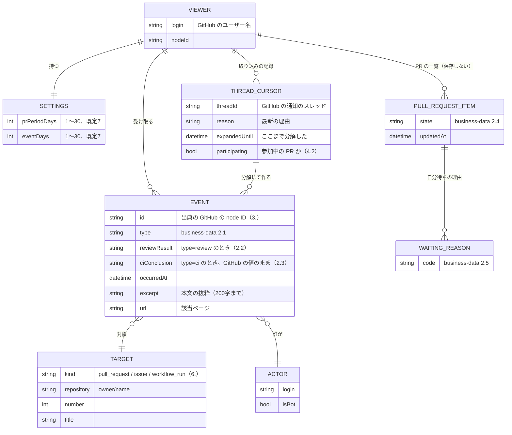

# ドメインモデル（domain-model.md）

- 作成: 2026-11-26（⑩.1 ドメイン設計）
- 入力: [business-data.md](../../requirements/business-data.md)、[requirements.md](../../requirements/requirements.md)、[acceptance.md](../../requirements/acceptance.md)、[non-functional.md](../quality/non-functional.md)、ADR-002・006・009・010
- 状態: 技術者が確認済み（2026-11-26）。保存の形式（JSON）と問い合わせの方式（REST と GraphQL の併用）は技術者が決めた（ADR-009・010）。「AI案」と書いた項目も技術者がこの内容で確認した。9. は依頼者が確認した（D-026）
- 更新: 2026-11-26 ⑫ の設計レビューを反映（DR-05・16・17・20。4.2〜4.4 に規則の番号 PT・WR・DN を振った）
- 更新: 2026-11-27 `AuthMethod` から `device_flow` を外した（CR-007）。10. 要確認 1 を確かめた結果を書いた（0-5）
- 更新: 2026-11-27 設定に画面の配色 `appearance` を足し、6. に `Appearance` を足した（CR-012・D-034）

業務の言葉と区分値は business-data.md が正である。この文書は、それを実装で使う型・判定の決まり・不変条件に直したもの。業務の区分値を新しく作らない。実装の都合で要る区分値は 6. にまとめた（技術者が確認済み）。

---

## 1. 全体像



| まとまり（集約） | 中身 | 保存 | 一緒に変えるもの |
| --- | --- | --- | --- |
| 出来事の記録 | 出来事（EVENT）、スレッドごとの取り込みの記録（THREAD_CURSOR）、GitHub の通知の問い合わせの記録（5.） | `events.json`（ADR-009） | 出来事を足すのと取り込みの記録を進めるのは、**同じ書き込みで行う**（7. の不変条件 I-5） |
| 設定 | 設定（SETTINGS）、使い始めの案内の進み具合、前回立ち上げた版 | `settings.json` | — |
| PR の一覧 | PR の一覧の行（PULL_REQUEST_ITEM）と自分待ちの理由 | **保存しない**（AI案）。立ち上げたときとリロードのときに取る（F-20）。メモリに持つだけ | — |
| 認証 | トークン、利用者（VIEWER） | トークンは safeStorage で暗号化したファイル（auth-flow.md）。利用者のユーザー名は立ち上げのたびに GitHub に聞く（保存しない。分解（M-0）はつながってからしか行わないため、つながる前には要らない。component-backend.md 5.1） | — |

---

## 2. 型（共有の型の素案）

画面とメインプロセスで共有する型。実装では `src/shared/` に置き、⑬ で最初に固める（8. barrier）。名前は英語、値は business-data.md のコードをそのまま使う。

```ts
// business-data.md 2.1
type EventType =
  | 'review_requested' | 'review' | 'comment' | 'ci'
  | 'mention' | 'assign' | 'participating';

// business-data.md 2.2
type ReviewResult = 'approved' | 'changes_requested' | 'commented';

// business-data.md 2.4
type PullRequestState = 'open' | 'draft' | 'merged' | 'closed';

// business-data.md 2.5（表示の順もこの順）
type WaitingReason =
  | 'review_pending' | 'changes_requested' | 'ci_failed' | 'approved' | 'assigned';

interface Actor { login: string; isBot: boolean }

interface Target {
  kind: TargetKind;            // 6.
  repository: string;          // "owner/name"
  number?: number;             // workflow_run には無い
  title: string;
  url: string;                 // PR・issue・ワークフロー実行のページ
}

interface GitHubEvent {
  id: string;                  // 3.
  type: EventType;
  reviewResult?: ReviewResult; // type = 'review' のときだけ
  ciConclusion?: string;       // type = 'ci' のときだけ。GitHub の値のまま（success、failure など）
  viaTeam?: boolean;           // type = 'review_requested' でチーム宛てのとき（F-03、S）
  target: Target;
  actor: Actor;
  occurredAt: string;          // ISO 8601（UTC）
  excerpt?: string;            // 本文の抜粋。Markdown の記号は落とさず、そのまま文字として出す
  url: string;                 // 出来事そのもののページ（コメントのアンカーなど）。https://github.com/ で始まる
  receivedAt: string;
}

interface PullRequestItem {
  id: string;                  // PR の node ID
  repository: string;
  number: number;
  title: string;
  url: string;
  state: PullRequestState;
  author: Actor;
  updatedAt: string;
  waitingReasons: WaitingReason[]; // 空なら自分待ちではない
}

interface Settings {
  schemaVersion: 1;
  desktopNotification: {
    byType: Record<EventType, boolean>; // 既定はすべて true
    bots: boolean;                      // bot の発言。既定 true（D-014）
  };
  prPeriodDays: number;        // 1〜30、既定 7（F-16）
  eventDays: number;           // 1〜30、既定 7（F-32）
  layout: Layout;              // 6.。既定 'tabs'（AI案）
  language: Language;          // 6.。既定 'ja'
  appearance: Appearance;      // 6.。既定 'system'（F-35。CR-012）
  onboarding: { completedAt?: string };
  lastLaunchedVersion?: string;  // F-36 (5) の判定に使う
}
```

- 自動起動（F-25）は設定ファイルに持たず、OS のログイン項目の状態を正とする（Electron の `app.getLoginItemSettings()`）。利用者が OS の設定で外しても食い違わないようにするため（AI案）
- 画面の配色（F-35）は、既定の `system` では OS の外観に従う。`light`・`dark` は OS の外観に関わらずその配色にする。メインが Electron の `nativeTheme.themeSource` に入れ、画面の `prefers-color-scheme` はそれに従う（CR-012。2026-11-27 までは設定に持たず、OS に従うだけだった）

---

## 3. 出来事の識別子

business-data.md 6. で「未定（⑩.1）」としていたもの。

| 出典（GitHub のもの） | 出来事の id | 例 |
| --- | --- | --- |
| コメント（IssueComment） | そのコメントの node ID | `IC_kwDO...` |
| レビュー（PullRequestReview） | そのレビューの node ID | `PRR_kwDO...` |
| レビュー依頼（ReviewRequestedEvent） | その出来事の node ID | `RRE_...` |
| アサイン（AssignedEvent） | その出来事の node ID | `AE_...` |
| PR・issue の本文でのメンション | PR・issue の node ID ＋ `:body` | `PR_kwDO...:body` |
| CI の結果（ワークフロー実行） | ワークフロー実行の node ID ＋ `#` ＋ 実行の回数（再実行で増える） | `WFR_kwLO...#2` |
| メンションの照合で出典が見つからなかったとき（4.1 規則 M-9） | GitHub の通知のスレッドの id ＋ `@` ＋ スレッドの更新時刻 | `1234567890@2026-11-26T03:54:21Z` |

- node ID は GitHub 全体で一意で、変わらない。**同じ出典を何度取り込んでも、出来事は1件**になる（Q-08 の「重複させない」）
- 1つの出典からは、多くても1件の出来事しか作らない（4.1 の優先順位）

---

## 4. 判定の決まり

いずれも GitHub への問い合わせから切り離した純粋な関数にする（ADR-011）。先にテストを書いてから作る（test-strategy.md 5.）。

### 4.1 出来事への分解と種類の判定

GitHub の通知は PR・issue などのスレッドごとに1件で、理由（reason）が付く（ADR-002）。理由で分解するスレッドを選び、スレッドの中の新しい出典（前回分解した時刻より後のもの）を1つずつ下の規則にかける。

**分解するスレッド**（AI案）

| GitHub の通知の理由 | 分解するか | 分解の材料 |
| --- | --- | --- |
| `review_requested`・`author`・`comment`・`mention`・`team_mention`・`assign` | する | スレッドの PR・issue の timelineItems（GraphQL。github-api.md 3.） |
| `ci_activity` | する | 利用者が起動したワークフロー実行（REST。github-api.md 4.） |
| `subscribed`・`manual`・`state_change`・`your_activity`・`approval_requested`（デプロイのレビュー依頼。W-05）・`security_alert`・`invitation`・`member_feature_requested`・`security_advisory_credit`・その他 | しない | — |

- スレッドの種類（subject.type）が `PullRequest`・`Issue`・`CheckSuite` のものだけを扱う。`Discussion` は F-04（C）を入れるときに足す
- 理由はスレッドの最新のものしか分からない。そのため、理由は「分解するスレッドを選ぶ」ためだけに使い、出来事の種類は**出典ごとに下の規則で決める**

**種類の規則**（上から順に当てはめ、最初に当たったもので決める）

| # | 条件 | 出来事の種類 | 根拠 |
| --- | --- | --- | --- |
| M-0 | 出典を作った人が利用者自身 | **出来事にしない** | business-data 2.1、AC-08 |
| M-1 | レビュー依頼で、依頼先が利用者 | `review_requested` | 2.1 |
| M-2 | レビュー依頼で、依頼先がチームで、スレッドの理由が `review_requested` | `review_requested`（`viaTeam: true`）| F-03（S）。チームの所属は `read:org` が無いと読めないため、スレッドの理由で代える（10. 要確認） |
| M-3 | アサインで、担当者が利用者 | `assign` | 2.1 |
| M-4 | 利用者が作った PR へのレビューのうち、**本文が空で、行へのコメントが既存のスレッドへの返信1件だけ**のもの | `comment` | **AI案**。GitHub ではレビューのスレッドへの返信も「レビュー」として記録されるが、利用者からはコメントに見えるため。見分けは `reviews` の一覧の `replyTo` で行う（⑬ で確かめた。CR-002） |
| M-5 | 利用者が作った PR へのレビュー（下書き中のレビューを除く） | `review`（結果は 2.2 に変換。取り消された（DISMISSED）レビューは `commented`。CR-005・D-029） | 2.1・2.2 |
| M-6 | 利用者が作った PR へのコメント | `comment` | 2.1 |
| M-7 | 本文（コメント・レビューの本文と行へのコメント・新しい PR や issue の本文）に `@利用者のユーザー名` がある。または利用者の所属チームの `@組織/チーム` がある | `mention` | 2.1、D-020 |
| M-8 | 他人が作った open の PR で、利用者が参加中（4.2）。その PR へのコメント・レビュー | `participating` | 2.1、F-02 |
| M-9 | スレッドの理由が `mention`・`team_mention` なのに、M-7 で1件も見つからなかった | `mention`を1件（出典は GitHub の通知の最新のコメント。`subject.latest_comment_url` を読み、発言者・開く先・抜粋に使う。空か読めなければ、対象の作者・対象のページ・抜粋無し。id は 3. の最後の行。CR-004） | **AI案**。照合の漏れで取りこぼさないための保険（Q-08） |
| — | どれにも当たらない | 出来事にしない | — |

- 利用者が作った PR では、自分へのメンションを含むコメントも `comment`（M-6）になる。自分の PR へのコメントであることの方が大事だと考えたため（**AI案**。10. 要確認）
- `@利用者のユーザー名` の照合は、大文字と小文字を区別せず、前後が英数字・`-`・`/` でないことを条件にする（`@foo` が `@foobar` や `@org/foo` に当たらない）
- CI（`ci_activity` のスレッド）は、利用者が起動したワークフロー実行のうち完了したものを、結果（conclusion）を問わず `ci` にする（F-05）。結果は GitHub の値のまま `ciConclusion` に入れる
- bot の判定は、出典を作った人のアカウントの種類が Bot かどうか（GraphQL の `__typename` が `Bot`）。`isBot: true` の出来事も一覧に出す（D-014）

### 4.2 参加中の PR

business-data.md 3. の「利用者がレビュー・コメントした、他人が作った open の PR」。次のどれかに当たれば参加中とし、スレッドの取り込みの記録に `participating: true` を残す（一度 true になったら戻さない）。

- PT-1: PR の `viewerLatestReview` がある（利用者がレビューしたことがある）
- PT-2: 分解した出典（タイムラインと `reviews` の一覧。CR-002）の中に、利用者のコメント・レビューがある
- PT-3: スレッドの理由が `comment` だったことがある

GitHub には「利用者がその PR でコメントしたか」を直接返す項目が無いため、上の3つで代える（**AI案**。10. 要確認）。

### 4.3 自分待ちの理由の判定

PR の一覧の各行に付ける。**WR-0: open（下書きを除く）の PR だけ**が対象（business-data.md 3.）。1つの PR に複数付くことがある。

| 理由 | 条件 | 材料（github-api.md 5.） |
| --- | --- | --- |
| WR-1: `review_pending` | 検索「`is:pr review-requested:@me`」の結果に入っている。この検索はチーム宛ての依頼も含む（F-03） | 検索 B |
| WR-2: `changes_requested` | 利用者が作った PR で、GitHub のレビューの判定（reviewDecision）が CHANGES_REQUESTED。**判定が空のとき**（レビューが必須でないリポジトリ）は、レビュアーごとの最新のレビュー（latestOpinionatedReviews）に CHANGES_REQUESTED が1つでもある | 検索 C |
| WR-3: `approved` | 利用者が作った PR で、reviewDecision が APPROVED。判定が空のときは、最新のレビューに APPROVED があり、CHANGES_REQUESTED が無い | 検索 C |
| WR-4: `ci_failed` | 利用者が作った PR で、最新のコミットのチェックの総合結果（statusCheckRollup）が FAILURE か ERROR（Actions 以外のチェックも含む。business-data 2.5） | 検索 C |
| WR-5: `assigned` | 担当者（assignees）に利用者が入っている | 検索 A |

- 2026-11-26 に依頼者のデータで確かめたところ、利用者が作った open の PR では reviewDecision が空だった。判定が空のときの代わりの決め方が要る
- PR の状態は GitHub の値から変換する: OPEN かつ下書き → `draft`、OPEN → `open`、MERGED → `merged`、CLOSED → `closed`

### 4.4 デスクトップ通知を出すかの判定

次のすべてに当たるときだけ出す（F-06・F-07・F-09、Q-06）。

1. DN-1: 取り込みの区分が `live`（6.）。立ち上げ時の取り戻し（`catchup`）で見つけた出来事には出さない（F-06、AC-12）
2. DN-2: 発生（occurredAt）から **10分以内**（**AI案**）。受け取れなかった間（ネットワークが切れていた間など）の出来事に、つながった後でまとめて出さないため（Q-06、AC-13）。1〜2回の失敗ですぐ戻った場合は、その間の出来事にも出せる
3. DN-3: その種類のデスクトップ通知がオン。bot の出来事なら、bot の設定もオン（F-09）
4. DN-4: まだ出していない（id で判定）

---

## 5. 取り込みの記録（カーソル）

取りこぼさない・重複させない（Q-08）ために、どこまで取り込んだかを `events.json` に残す。

| 記録 | 中身 | 使い方 |
| --- | --- | --- |
| GitHub の通知の問い合わせの記録 | 前回の応答の `ETag`、前回の成功の時刻 | 次の問い合わせで `If-None-Match` に前回の `ETag` を入れ（`If-Modified-Since` では 304 にならない。CR-003）、`since` に「前回の成功の時刻 − 5分」を入れる。`all=true` で、GitHub 側で既読にしたスレッドも取る（既読はそろえないため。D-007） |
| スレッドごとの取り込みの記録 | スレッドの id、最新の理由、分解した時刻（expandedUntil）、参加中か、続けて失敗した回数 | スレッドの更新時刻が expandedUntil より新しければ、「expandedUntil − 5分」以降の出典を分解する。重なった分は id で重複を除く |
| 立ち上げ時 | — | 「前回の成功の時刻 − 5分」と「今 − 出来事の一覧の日数」の新しい方から取る。保存が無い（初回・壊れて捨てた）ときは「今 − 出来事の一覧の日数」から |

- 5分の重なり（**AI案**）は、GitHub 側の時刻のずれと、GitHub の通知が作られるまでの遅れを吸収するため。重なった分は id で除くので、重複はしない
- 出来事の一覧の日数を後から長くしても、それより前の出来事は取り直さない（その時点から先に溜まる）。AC-34 は表示の日数の確認なので影響しない
- PR の一覧の期間も、出来事の一覧の日数と同じく「今の時刻 − 日数」の時刻で数える。日付では数えない（github-prs と同じ。github-api.md 5.、D-028、DR-17）

---

## 6. 技術上の区分値（設計で追加。技術者が確認済み）

business-data.md に無い、実装の都合で要る区分値。業務の言葉は business-data.md 4. の対応表に合わせた。

| 型 | コード | 意味 | 使うところ |
| --- | --- | --- | --- |
| 対象の種類 `TargetKind` | `pull_request`・`issue`・`workflow_run` | 出来事の対象 | 出来事の一覧の表示 |
| 取り込みの区分 `IngestMode` | `catchup`・`live` | 立ち上げ時の取り戻し／定期の取り込み | 4.4 |
| 受け取りの状態 `IngestState` | `ok`・`syncing`（取り込み中。Q-03）・`offline`（ネットワークが切れた）・`auth_failed`（認証が切れた）・`rate_limited`（利用制限にかかった）・`github_error`（GitHub の障害・想定外の応答）・`signed_out`（認証していない） | N-08 の「受け取れていないことと理由」 | 画面の上部の表示（component-frontend.md） |
| デスクトップ通知の失敗の理由 `DesktopNotificationFailure` | `outside_applications_folder`（Mac でアプリケーションフォルダの外から開いている）・`os_rejected`（OS が断った。通知の設定がオフなど） | N-09 の「考えられる理由」 | 画面の上部の表示、案内 (4) |
| 画面の並べ方 `Layout` | `tabs`・`side_by_side` | F-33 | 設定 |
| 表示言語 `Language` | `ja`・`en` | F-26 | 設定 |
| 画面の配色 `Appearance` | `system`（OS に合わせる）・`light`・`dark` | F-35（CR-012 で追加） | 設定 |
| 認証方式 `AuthMethod` | `pat` | ADR-004（2026-11-27 に `device_flow` を外した。CR-007） | 認証 |
| 認証の状態 `AuthStatus` | `signed_out`・`keychain_notice`（版が変わり、キーチェーンの確認の前の案内を出している）・`signing_in`・`signed_in`・`auth_failed` | F-27・F-36 (5) | 画面の切り替え（component-frontend.md） |
| IPC の失敗 `IpcErrorCode` | ipc-contract.md 4. | 画面から頼んだ処理の失敗 | IPC |

---

## 7. 核の不変条件（barrier）

全機能が頼る決まり。保証する場所を1か所に決め、⑬ で最初に直列で固める（設計フレーム 2.5節）。開発は直列（D-002）なので、並列のためではなく「AI が実装中に勝手に変えない範囲」として扱う。

| # | 不変条件 | 保証する場所 | 確かめ方 |
| --- | --- | --- | --- |
| I-1 | 出来事は出典1つにつき多くても1件。同じ出典を何度取り込んでも1件 | `main/core`（分解）と `main/store`（id で重ねる） | 単体（同じ応答を2回流す） |
| I-2 | 利用者自身の操作は出来事にしない | `main/core` の規則 M-0 | 単体 |
| I-3 | 種類・レビューの結果・PR の状態・自分待ちの理由は business-data.md の区分値だけ。CI の結果は GitHub の値のまま | `shared` の型と、読み込み時の検査（zod） | 型検査、単体 |
| I-4 | 保存する出来事は30日以内。一覧に出すのは出来事の一覧の日数以内 | `main/store`（削除）、`main/ingest`（一覧に渡す範囲） | 結合（AC-40・AC-34） |
| I-5 | 取り込みの記録は、出来事を保存し終えた後にだけ進める（同じ書き込みで行う） | `main/store` | 結合（保存の途中で失敗させる） |
| I-6 | デスクトップ通知は 4.4 に当たるときだけ出す | `main/core` の判定関数 | 単体（偽の時計） |
| I-7 | トークンは `main/auth` の外に出さない（ログ・IPC・保存した出来事・URL・画面） | `main/auth`、`main/log` | 単体、コードの検査（Q-10） |
| I-8 | 外部で開く URL・コピーする URL は `https://github.com/` で始まるものだけ | `main/core` の URL の検査 | 単体（Q-11） |

---

## 8. ⑬ へ（barrier の範囲）

- `src/shared/`: 2. の型、6. の区分値、IPC の契約（ipc-contract.md）
- `src/main/core/`: 4. の判定と I-8 の URL の検査。テストを先に書く
- 記録した GitHub の応答（架空のデータに置き換えたもの）。4.1・4.3 のテストの材料（github-api.md 8.）

---

## 9. 依頼者に確かめたこと（業務への影響があるもの）

2026-11-26 に依頼者が3つとも AI案のとおりとした（decisions.md D-026）。

| # | 内容 | AI案 |
| --- | --- | --- |
| 1 | 自分の PR で、レビューのスレッドへの返信は、レビューとコメントのどちらとして出すか（M-4） | コメント |
| 2 | 自分の PR で、自分へのメンションを含むコメントは、コメントとメンションのどちらとして出すか（M-6 と M-7 の順） | コメント |
| 3 | 発生から10分より前の出来事にはデスクトップ通知を出さない（4.4 の 2）。ネットワークが長く切れていた間の出来事に、まとめて出さないため | 10分 |

---

## 10. 要確認（⑬ で、記録した実際の応答で確かめる）

| # | 内容 | 確かめなかった場合の扱い | 誰が・いつ |
| --- | --- | --- | --- |
| 1 | `notifications`・`repo` スコープのトークンで、所属チームの一覧（REST `GET /user/teams`）とレビュー依頼先のチームの名前を読めるか | 読めなければ、チームへのメンションは「理由が `team_mention` のスレッドで、`@組織/` を含む本文」で判定する。チーム宛てのレビュー依頼は M-2 のとおりスレッドの理由で代える | AI・⑬ の最初。**確かめた**（2026-11-27。build-plan.md 5. の 0-5）: 所属チームの一覧（REST `GET /user/teams`）は classic PAT（`repo`・`notifications`）で読めた（gh CLI と同じ9件）。レビュー依頼先のチームの名前（GraphQL の `Team`）は `INSUFFICIENT_SCOPES` で読めない（`read:org` が要る）。チーム宛てのレビュー依頼は M-2 のとおりスレッドの理由で代える（github-api.md 3.） |
| 2 | `ci_activity` のスレッドの応答の形（subject.url が空か、何を指すか）。依頼者のデータには直近で1件も無かった | 本リポジトリ（github-inbox）の CI の実行で届く GitHub の通知とワークフロー実行を、読み取りだけで記録する。CI を動かす push は技術者か、技術者に頼まれた AI が行う。**AI は記録のために GitHub 上で出来事を起こさない**（DR-16） | AI・⑬ でリポジトリと CI を用意した後。**確かめた**（⑬。2026-11-26。github-api.md 4.） |
| 3 | timelineItems の `since` が、レビューを提出した時刻で絞るか | 重なり（5分）を広げる | **不要になった**（⑬。レビューは `reviews` の一覧で取り、`submittedAt` で自分で絞るため。CR-002） |
| 4 | 参加中の判定（4.2）の3つで、取りこぼしが無いか | 依頼者の実データで確かめる（⑮） | AI・⑬（記録した応答で、PT-1〜3 の判定と M-8 の出来事を作れることを確かめた）、依頼者・⑮（取りこぼしが無いか） |
| 5 | M-4（返信だけのレビュー）の見分け方が、実際の応答で成り立つか | — | **確かめた**（⑬。`timelineItems` には返信が出てこないため `reviews` の一覧で取る。`replyTo` は REST の `in_reply_to_id` と一致した。CR-002） |
| 6 | 依頼者の最近のデータに無い場面（返信だけのレビュー・チーム宛てのレビュー依頼・bot の発言など）の応答 | 起きたときに読み取りだけで記録する。それまでは、記録した応答をテストの中で書き換えて使う（test-conventions.md 3.。DR-16） | AI・⑬〜⑭ |
