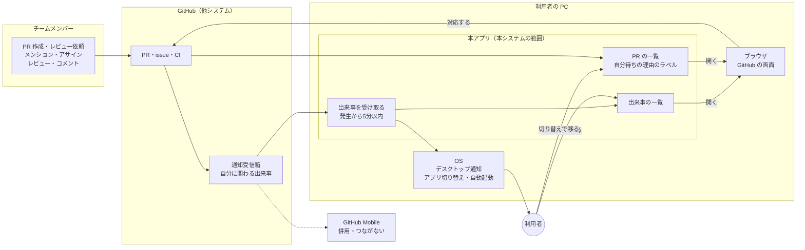
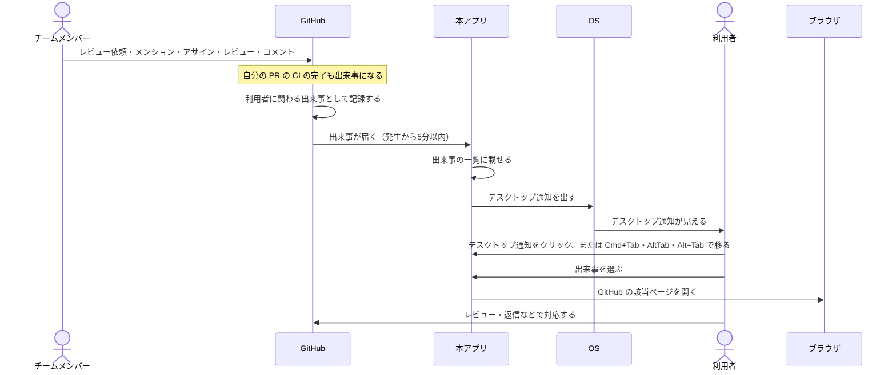
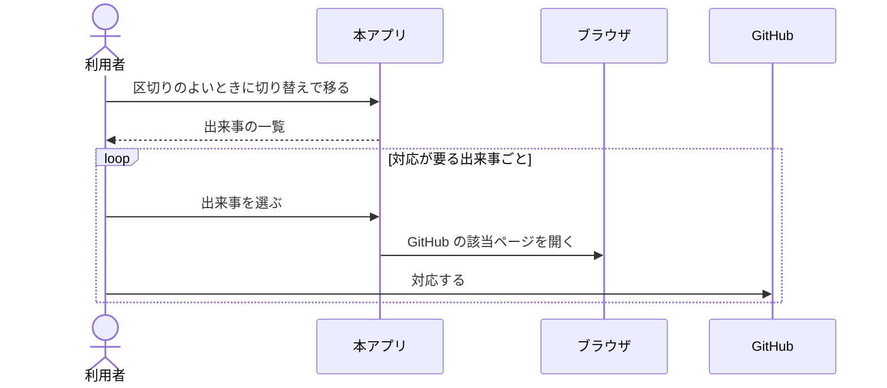
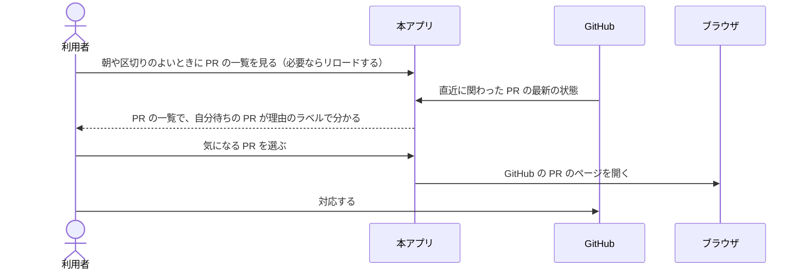
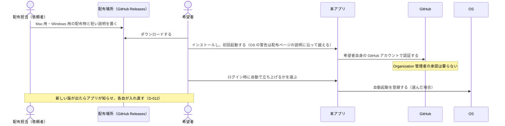

# 業務フロー（business-flow.md）

- 作成: 2026-11-26（②.5 業務フローを描く）
- 素材: [intent.md](intent.md)、[hearing-memo.md](hearing-memo.md)
- 更新: 2026-11-26 境界の論点への回答を反映。済み／既読は一旦管理しない（D-007）、CI の範囲（D-008）、立ち上がっていなかった間の出来事（D-009）
- 更新: 2026-11-26 ③ の決定を反映（更新の知らせ方、閉じたら終了、遡る日数。D-012）
- 更新: 2026-11-26 モックアップの確認を反映。PR の一覧は1つにまとめ、自分待ちは理由のラベルで示す。遡る日数は出来事の一覧の日数に従う（D-016）
- 更新: 2026-11-26 F6（週1回、PR のリンクをまとめてコピーする）を追加（D-017）
- 更新: 2026-11-26 F4 を「アプリの案内で使い始める」形に変更（D-024）
- 状態: 依頼者が確認済み（2026-11-26）
- 更新: 2026-11-26 ⑫ の設計レビューを反映。後の工程で決めた「未定」を直し、OAuth App の確認の予定を書き足した（DR-08・11）

ここでいう「業務」は、利用者が GitHub 上で自分に関わる出来事に気づき、対応するまでの日々の流れと、アプリを希望者に配って使い始めてもらう流れを指す。

---

## 1. 登場人物とシステム

| レーン | 誰・何 | 本アプリを直接触るか |
| --- | --- | --- |
| 利用者 | 依頼者本人、または配布を受けたチームの希望者 | **触る** |
| チームメンバー | PR を作る人、レビューする人、メンション・アサインする人 | 触らない（GitHub 上で普段どおり作業するだけ） |
| 配布担当 | 依頼者。アプリを用意して希望者に渡す | 触る（配布物を作る） |
| GitHub（github.com） | PR・issue・レビュー・コメント・CI（GitHub Actions）・通知受信箱 | 他システム |
| 本アプリ | 自分に関わる出来事の受け取り・デスクトップ通知・一覧、PR の一覧（自分待ちの理由のラベル付き） | **本システム** |
| OS（Mac / Windows） | デスクトップ通知、アプリの切り替え（Cmd+Tab・AltTab・Alt+Tab）、ログイン時の自動起動 | 他（OS の機能） |
| ブラウザ | GitHub の画面を開いて対応する | 他 |
| GitHub Mobile | 併用するが、本アプリとはつながない（D-004） | 範囲外 |

- **Organization の管理者は登場しない**。外部のアプリやトークンから会社のリポジトリを読むのに、管理者の承認は要らない（依頼者に確認済み。新しく登録する OAuth App が Organization のアクセス制限を受けるかは、⑬ の最初に確かめる。docs/design/api-contract/auth-flow.md 7.）
- **チームメンバーは本アプリを触らない**。出来事を起こす側として GitHub 上にいるだけで、本アプリを使うかどうかは本人次第（希望者は「利用者」レーンに入る）

---

## 2. 全体像（本システムの範囲）

---

## 3. 業務フロー

### F1 自分に関わる出来事に気づき、すぐ対応する

きっかけになる出来事は4種類（hearing-memo.md 3.）: レビュー依頼、自分の PR への反応（レビュー・コメント・CI の結果）、メンション、アサイン。

| # | 誰が | いつ | 何を | どのシステムで |
| --- | --- | --- | --- | --- |
| 1 | チームメンバー | 普段の作業中 | PR を作ってレビュアーに利用者を指定する。またはメンション・アサイン・レビュー・コメントをする | GitHub |
| 2 | GitHub | 1 の直後（自分の PR の CI が終わったときも） | 利用者に関わる出来事として記録する | GitHub |
| 3 | 本アプリ | 1 から5分以内 | 出来事を受け取り、出来事の一覧に載せ、デスクトップ通知を出す | 本アプリ・OS |
| 4 | 利用者 | デスクトップ通知を見たとき | デスクトップ通知をクリックするか、OS の切り替えで本アプリに移る | OS・本アプリ |
| 5 | 利用者 | すぐ | 出来事から GitHub の該当ページを開き、対応する | 本アプリ・ブラウザ・GitHub |

### F2 後でまとめて処理する

デスクトップ通知では「ある」と知るだけにして、区切りのよいときに出来事の一覧を見て片付ける。済み／既読は管理しないため、どこまで見たかを本アプリは覚えない（D-007）。

| # | 誰が | いつ | 何を | どのシステムで |
| --- | --- | --- | --- | --- |
| 1 | 利用者 | 区切りのよいとき | OS の切り替えで本アプリに移り、出来事の一覧を見る | OS・本アプリ |
| 2 | 利用者 | 対応が要る出来事があれば | GitHub の該当ページを開いて対応する | 本アプリ・ブラウザ・GitHub |

### F3 自分待ちの PR を見渡して、抜け漏れを確かめる

出来事の一覧が「気づいたもの」を片付けるためのものなのに対し、PR の一覧は自分待ちの PR を確かめるために使う（依頼者の回答: 両方を使い分ける）。

| # | 誰が | いつ | 何を | どのシステムで |
| --- | --- | --- | --- | --- |
| 1 | 利用者 | 朝や区切りのよいとき | OS の切り替えで本アプリに移り、PR の一覧を見る | OS・本アプリ |
| 2 | 本アプリ | 立ち上げたとき・利用者がリロードしたとき | 直近に関わった PR の最新の状態を GitHub から集め、1つの一覧に更新の新しい順で出す。自分待ちの PR には理由のラベルを付ける。自動では最新にしない（D-013、D-016） | 本アプリ・GitHub |
| 3 | 利用者 | 気になる PR があれば | GitHub の PR のページを開いて対応する | 本アプリ・ブラウザ・GitHub |

「自分待ちの PR」と「直近に関わった PR」の範囲は business-data.md 3. で固定した（D-010）。期間は既定7日で、利用者が変えられる。

### F6 週に1回、PR のリンクをまとめてコピーする

依頼者は github-prs の「Copy All Links」を週1回必ず使っている（D-017）。コピーしたリンクをどこに貼るかは本アプリの範囲外。

| # | 誰が | いつ | 何を | どのシステムで |
| --- | --- | --- | --- | --- |
| 1 | 利用者 | 週に1回 | PR の一覧を開き、必要なら期間・検索・絞り込みで対象を決める | 本アプリ |
| 2 | 利用者 | 対象が決まったら | 「すべてのリンクをコピー」で、一覧に出ている PR の URL をまとめてクリップボードに入れる | 本アプリ・OS |
| 3 | 利用者 | その後 | 必要な場所に貼り付ける | 本アプリの範囲外 |

### F4 希望者に配り、使い始めてもらう

| # | 誰が | いつ | 何を | どのシステムで |
| --- | --- | --- | --- | --- |
| 1 | 配布担当 | 新しい版ができたとき | Mac 用・Windows 用の配布物と短い説明（初回の OS の警告の越え方・対応 OS）を配布場所に置く。詳しい手順書は補助（F-37） | 配布場所（GitHub Releases） |
| 2 | 希望者 | 使いたくなったとき | ダウンロードしてインストールし、初回の OS の警告を配布ページの説明に沿って越える | 利用者の PC |
| 2.5 | 本アプリ | 初回起動のとき | 使い始めを案内する（アプリケーションフォルダへの移動、認証、GitHub の通知設定の確認、デスクトップ通知の確認。F-36） | 本アプリ |
| 3 | 希望者 | 初回起動のとき | 自分の GitHub アカウントで認証する | 本アプリ・GitHub |
| 4 | 希望者 | 初回起動のとき（後から変更も可） | ログイン時に自動で立ち上げるかを選ぶ | 本アプリ・OS |
| 5 | 希望者 | 以降 | F1〜F3 のとおり使う | 本アプリ |

### F5 アプリを立ち上げておく

| # | 誰が | いつ | 何を | どのシステムで |
| --- | --- | --- | --- | --- |
| 1 | OS | PC にログインしたとき | 自動起動を選んだ利用者の本アプリを立ち上げる | OS |
| 2 | 利用者 | 自動起動を選んでいない場合 | 自分で本アプリを立ち上げる | OS |
| 3 | 本アプリ | 立ち上がっている間 | 出来事を受け取り続ける。ウィンドウは開いたままにしておき、OS の切り替えで移れる | 本アプリ・OS |
| 4 | 本アプリ | 立ち上げたとき | 立ち上がっていなかった間に起きた出来事も一覧に表示する。これらにはデスクトップ通知を出さない（D-009）。出来事の一覧の日数（1〜30日、既定7日）まで遡る（D-012、D-016） | 本アプリ |
| 5 | 利用者 | 使い終わったとき | ウィンドウを閉じるとアプリは終了し、出来事の受け取りも止まる（D-012） | 本アプリ |

---

## 4. 本アプリがやること・他に任せること

| 本アプリがやる | 他に任せる |
| --- | --- |
| 自分に関わる出来事を受け取る（5分以内） | 出来事を起こす・記録する（GitHub） |
| デスクトップ通知を出す（表示は OS） | 通知の表示、アプリの切り替え、自動起動の仕組み（OS） |
| 出来事の一覧（立ち上がっていなかった間の出来事も表示） | レビュー・承認・返信などの対応（GitHub。ブラウザで開く） |
| PR の一覧（自分待ちの理由のラベル付き） | スマートフォンへの通知（GitHub Mobile。つながない） |
| GitHub の該当ページをブラウザで開く | |
| ログイン時に自動で立ち上げるかの設定 | |
| 希望者が自分の GitHub アカウントで使い始められること（初回の案内はアプリが行う。配布物と短い説明は配布担当が用意） | |

今回やらないこと: 出来事の済み／既読の管理（未処理の管理、GitHub の通知受信箱の既読との連動）。「一旦」やらないと決めたもので、③ では Won't（今回はやらない）の候補とする（D-007）。

---

## 5. 境界の論点

②.5 で、本アプリと GitHub の境目として次の論点が浮かんだ。

| 論点 | 結論・状態 |
| --- | --- |
| 「自分に関わる出来事」を GitHub の判定（通知受信箱に入るもの）に任せるか、本アプリが独自に選ぶか | **決めた**（③・⑦）: GitHub の通知 API を起点にし、どれを出来事にするかは本アプリの規則で選ぶ（ADR-002、docs/design/components/domain-model.md 4.1）。以下は決める前の検討の記録。済み／既読を管理しない（D-007）ため、通知受信箱と同じ単位で扱う理由はなくなった。通知受信箱の中身は各自の GitHub 側の通知設定（Watch しているリポジトリなど）で変わり、自分に関わらない出来事も混ざりうる点は残る（困りごと P3 と関わる）。範囲は依頼者が ③ で、取り込み元は技術者が ⑦ で決める |
| CI の結果をどこまで出来事として扱うか | **決定**: 自分が起動した GitHub Actions のワークフローの完了まででよい（GitHub の通知で CI の完了が届く範囲。通知の理由 `ci_activity`）。GitHub Actions 以外の CI は扱わない（D-008） |
| アプリが立ち上がっていなかった間の出来事の扱い | **決定**: 次に立ち上げたとき一覧に表示する。デスクトップ通知は出さない（D-009） |

出典: GitHub の通知の理由 https://docs.github.com/en/rest/activity/notifications#about-notification-reasons

---

## 6. 未定の事項

| 項目 | 状態 |
| --- | --- |
| 配布物を置く場所 | 決めた（⑧）: GitHub Releases（ADR-005）。新しい版はアプリが知らせ、各自が入れ直す（D-012） |
| ウィンドウを閉じたときの動き | 決定: 閉じたら終了する（D-012） |
| Dock・タスクバーのアイコンに数を出すか | 決定: 出さない（D-013） |
| 「自分待ちの PR」「直近に関わった PR」の範囲 | 決定（business-data.md 3.、D-010） |
| チーム宛てのレビュー依頼を出来事に含めるか | 決定: 含める（S。D-012） |
| Organization が SAML SSO を使っているか | 決定: 使っていない（⑦ で確認。D-019） |
